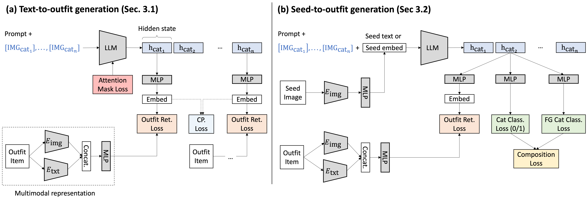
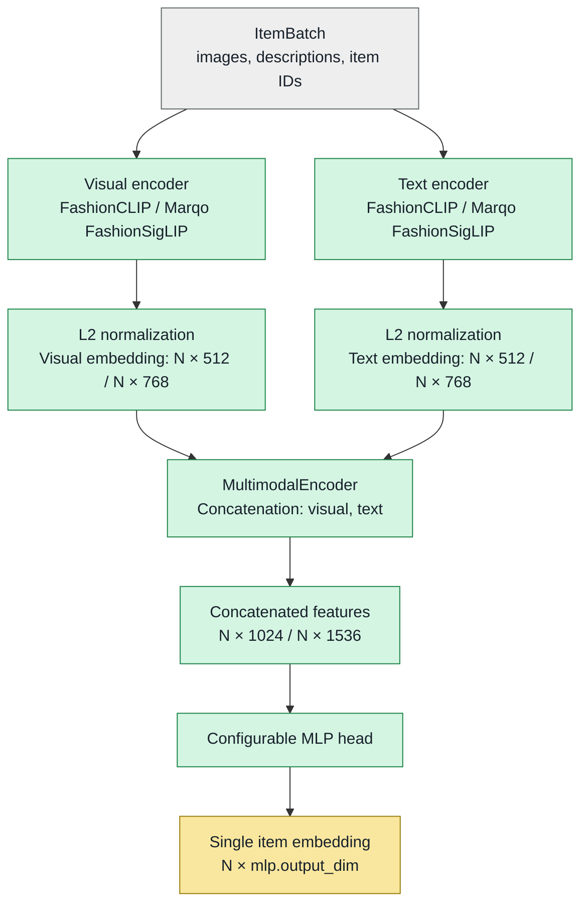
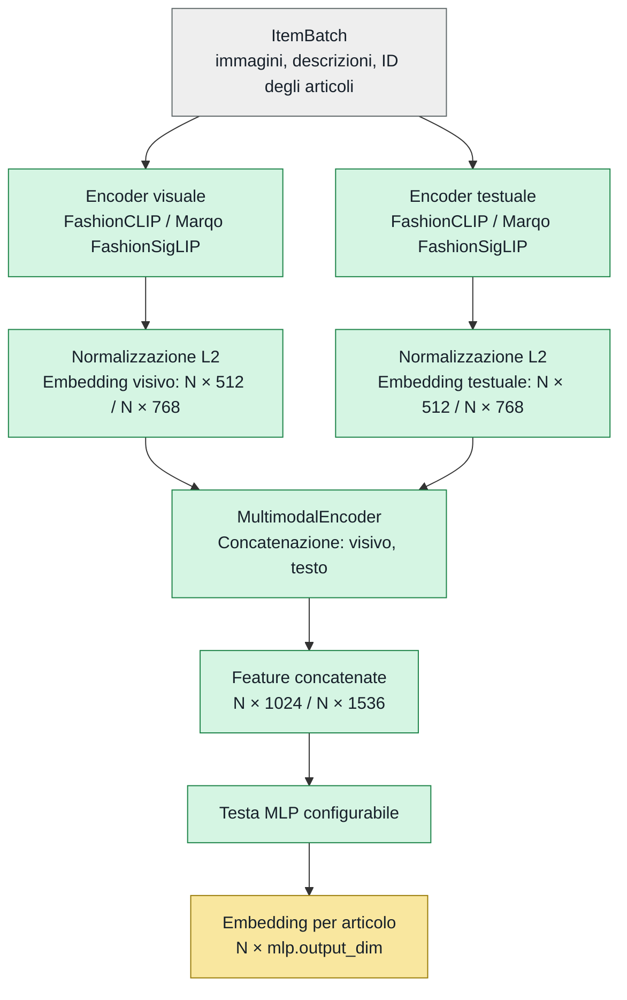

> [!NOTE]
> This README is available in English below and in [Italian / italiano](#versione-italiana).
> La [versione italiana](#versione-italiana) si trova nella seconda parte del documento.

# Text2Outfit



*Figure 2 / Figura 2 — Reference architecture / Architettura di riferimento,
[Zhai et al., Text2Outfit, ICCV 2025](https://openaccess.thecvf.com/content/ICCV2025/papers/Zhai_Text2Outfit_Controllable_Outfit_Generation_with_Multimodal_Language_Models_ICCV_2025_paper.pdf).*

## English

A project for loading fashion items, precomputing FashionCLIP or Marqo
FashionSigLIP embeddings, and processing them with configurable MLPs.

### Contents

- [Overview](#overview)
- [Modules](#modules)
- [Architecture](#architecture)
- [Environment setup](#environment-setup)
  - [Windows PowerShell](#windows-setup-powershell)
  - [Linux and macOS](#linux-and-macos)
- [Local dataset](#local-dataset)
- [Usage](#usage)
- [Tests](#tests)
- [Italian version](#versione-italiana)

### Overview

The project reads fashion item images and descriptions and produces visual
and text features with FashionCLIP or Marqo FashionSigLIP. The data pipeline
loads individual items, applies the selected image transform, and groups
items into batches. Each modality is L2-normalized, then `MultimodalEncoder`
concatenates the visual and text embeddings and applies a configurable MLP
head to produce one vector per item.

For component details and responsibilities, see the [model overview](model/README.md)
and [data pipeline](data/README.md).

### Modules

| Module | Responsibility | Documentation |
|---|---|---|
| `preprocessing` | Loads images, corrects EXIF orientation, and converts color modes. | [README](preprocessing/README.md) |
| `data` | Defines types, transforms, collate functions, and DataLoaders. | [README](data/README.md) |
| `data/polyvore` | Downloads and parses Polyvore images and metadata. | [README](data/polyvore/README.md) |
| `model` | Exposes the visual, text, and multimodal encoders. | [README](model/README.md) |
| `model/multimodal_representation` | Encodes images and text, applies L2 normalization, concatenates the embeddings, and applies an MLP head. | [README](model/multimodal_representation/README.md) |
| `model/mlp` | Builds independent MLPs with configurable layer widths and depth. | [README](model/mlp/README.md) |
| `scripts` | Downloads Polyvore and precomputes item embeddings. | [README](scripts/README.md) |
| `tests` | Checks data loading and encoder behavior. | [README](tests/README.md) |

### Architecture

Per-modality dimensions are `512 / 768`: FashionCLIP and Marqo FashionSigLIP,
respectively. Each encoder returns one feature vector per item. Use matching
checkpoints and image transforms for the two modalities.



L2 normalization is applied to each modality before concatenation, in
visual-then-text order. The MLP receives 1024 features for FashionCLIP or 1536
for Marqo FashionSigLIP. Pass it as the third argument to `MultimodalEncoder`;
its `input_dim` must match the sum of the two encoder dimensions. The final
`output_dim` is the MLP's output width.
For encoder details, trainability, and frozen Marqo backbone sharing, see the
[representation guide](model/multimodal_representation/README.md).

### Environment setup

Run these commands from the project root.

#### Windows setup (PowerShell)

Create and activate the environment:

```powershell
py -m venv .venv
.\.venv\Scripts\Activate.ps1
python -m pip install --upgrade pip
python -m pip install -r requirements.txt
```

#### Linux and macOS

Create and activate the environment:

```bash
python3 -m venv .venv
source .venv/bin/activate
python -m pip install --upgrade pip
python -m pip install -r requirements.txt
```

Polyvore requires an authorized Hugging Face account. Once dataset access has
been granted, save your token locally:

```bash
hf auth login
```

See the [scripts guide](scripts/README.md) for commands available after setup.
Authentication and Polyvore resource resolution are described in the
[dataset guide](data/polyvore/README.md).

### Local dataset

Download the full Polyvore dataset to the default folder:

PowerShell:

```powershell
python -m scripts.download_polyvore
```

Linux (Bash):

```bash
python -m scripts.download_polyvore
```

The item loader first looks for Polyvore in `datasets/polyvore-outfits/`, then
in the Hugging Face cache, and downloads only missing resources. The download
command above retrieves the full repository and reuses unchanged files. The local
folder must mirror the dataset repository structure.

Use `--output-dir` to choose a different download path. Set
`DatasetRequest.root` to choose the path used by the item loader. Partial local datasets are
supported: remote fallback applies only to missing files.

For details, see the [data pipeline](data/README.md), [Polyvore format and
loading](data/polyvore/README.md), and [downloader flags](scripts/README.md#download-polyvore).

To reuse the original project’s dataset, set the loader root to
`Path("../OutfitTransformer/datasets/polyvore-outfits")`.

### Usage

Load a batch of items and encode the images and descriptions with FashionCLIP:

```python
from pathlib import Path

import torch

from data import (
    DataSplit,
    DatasetRequest,
    LoaderConfig,
    build_fashion_clip_transform,
    create_item_loader,
    get_dataset_source,
)
from model import FashionCLIPTextEncoder, FashionCLIPVisualEncoder, MLP, MultimodalEncoder

source = get_dataset_source("polyvore")
dataset = source.item_dataset(
    DatasetRequest(
        subset="nondisjoint",
        split=DataSplit.TRAIN,
        root=Path("datasets/polyvore-outfits"),
    ),
    build_fashion_clip_transform(),
)
loader = create_item_loader(dataset, config=LoaderConfig(batch_size=4))
batch = next(iter(loader))
images = torch.stack([item.image for item in batch.model_items])
descriptions = [item.text for item in batch.model_items]

visual_encoder = FashionCLIPVisualEncoder(trainable=False).eval()
text_encoder = FashionCLIPTextEncoder(trainable=False).eval()
mlp = MLP(visual_encoder.output_dim + text_encoder.output_dim, 256, hidden_dims=[512, 256])
encoder = MultimodalEncoder(visual_encoder, text_encoder, mlp).eval()
with torch.inference_mode():
    embeddings = encoder(images, descriptions)

print(embeddings.shape)  # [N, 256]
```

For Marqo FashionSigLIP, use its matching image transform and the two Marqo
encoders. A complete example, including a shared backbone, is in the
[encoder guide](model/multimodal_representation/README.md#esempi).

### Precomputed embeddings and MLPs

Precompute one split with frozen encoders:

```bash
python -m scripts.precompute_embeddings --subset nondisjoint --split train
python -m scripts.precompute_embeddings --marqo-fashion-siglip --batch-size 32
```

Outputs are saved under `precomputed_embeddings/<model>/<subset>/<split>/`
as PyTorch shards and a manifest. The [script guide](scripts/README.md#precomputare-gli-embedding)
explains flags, reading shards, and reusing the dataset in `OutfitTransformer`.

Create as many independent MLPs as needed. Each entry in `hidden_dims` adds
one hidden layer with that width:

```python
from model import MLP

small = MLP(input_dim=1024, output_dim=128, hidden_dims=[256])
deep = MLP(input_dim=1024, output_dim=64, hidden_dims=[512, 256, 128])
```

Use input width 1024 for FashionCLIP or 1536 for Marqo. See the
[MLP guide](model/mlp/README.md) for four different networks in a `ModuleDict`.

### Tests

```bash
python -B -m unittest discover -s tests -v
```

Tests cover the local Parquet-to-batch pipeline, Arrow and metadata caches,
remote fallback, validation, L2 normalization, concatenation, FashionCLIP gradients,
and frozen Marqo backbone sharing. They use synthetic data, small locally initialized CLIP
models, and a substitute Marqo backbone. Network calls are mocked; full model
weights and embedding quality are not checked. Additional tests cover MLP
training, independent architectures, and precomputation from local Parquet
through validated shards and manifest, including overwrite protection.

See the [test guide](tests/README.md) for scope and limitations.

---

## Versione italiana

[Back to English / Torna alla versione inglese](#english)

Progetto per caricare articoli fashion, precomputare embedding FashionCLIP o
Marqo FashionSigLIP ed elaborarli con MLP configurabili.

### Indice

- [Panoramica](#panoramica)
- [Moduli](#moduli)
- [Architettura generale](#architettura-generale)
- [Creazione dell'ambiente](#creazione-dellambiente)
  - [Windows PowerShell](#windows-powershell)
  - [Linux e macOS](#linux-e-macos)
- [Dataset locale](#dataset-locale)
- [Utilizzo](#utilizzo)
- [Test](#test)

### Panoramica

Il progetto legge immagini e descrizioni di articoli fashion e produce feature
visive e testuali con FashionCLIP o Marqo FashionSigLIP. La pipeline dati legge
singoli articoli, applica la transform scelta e costruisce batch. Ogni modalità
viene normalizzata L2; `MultimodalEncoder` concatena gli embedding visivo e
testuale e applica una testa MLP configurabile per ottenere un vettore per articolo.

Per approfondire componenti e responsabilità: [panoramica del modello](model/README.md)
e [pipeline dei dati](data/README.md).

### Moduli

| Modulo | Responsabilità | Documentazione |
|---|---|---|
| `preprocessing` | Legge immagini, corregge l’orientamento EXIF e converte il colore. | [README](preprocessing/README.md) |
| `data` | Definisce tipi, transform, collate e DataLoader. | [README](data/README.md) |
| `data/polyvore` | Scarica e interpreta immagini e metadata Polyvore. | [README](data/polyvore/README.md) |
| `model` | Espone gli encoder visuale, testuale e multimodale. | [README](model/README.md) |
| `model/multimodal_representation` | Codifica immagini e testi, applica L2, concatena gli embedding e applica una testa MLP. | [README](model/multimodal_representation/README.md) |
| `model/mlp` | Crea MLP indipendenti con larghezza e profondita configurabili. | [README](model/mlp/README.md) |
| `scripts` | Scarica Polyvore e precomputa gli embedding degli articoli. | [README](scripts/README.md) |
| `tests` | Verifica caricamento dati e comportamento degli encoder. | [README](tests/README.md) |

### Architettura generale

Le dimensioni per modalità sono `512 / 768`: rispettivamente FashionCLIP e
Marqo FashionSigLIP. Ogni encoder restituisce un vettore per articolo. Le due
modalità devono usare checkpoint e trasformazione immagine corrispondenti.



La normalizzazione L2 si applica a ciascuna modalità prima della concatenazione,
nell’ordine visivo, testo. L'MLP riceve 1024 feature per FashionCLIP o 1536
per Marqo FashionSigLIP. Si passa come terzo argomento a `MultimodalEncoder`;
il suo `input_dim` deve essere la somma delle dimensioni dei due encoder.
La dimensione finale `output_dim` e quella dell'output dell'MLP.
Dettagli degli encoder, trainabilità e condivisione del backbone
Marqo congelato sono nella [guida della rappresentazione](model/multimodal_representation/README.md).

### Creazione dell'ambiente

Eseguire i comandi dalla cartella principale del progetto.

#### Windows PowerShell

Creazione ambiente:

```powershell
py -m venv .venv
.\.venv\Scripts\Activate.ps1
python -m pip install --upgrade pip
python -m pip install -r requirements.txt
```

#### Linux e macOS

Creazione ambiente:

```bash
python3 -m venv .venv
source .venv/bin/activate
python -m pip install --upgrade pip
python -m pip install -r requirements.txt
```

Polyvore richiede un account Hugging Face autorizzato. Dopo aver ottenuto
l'accesso al dataset, salvare il token localmente:

```bash
hf auth login
```

Per i comandi disponibili dopo il setup: [guida degli script](scripts/README.md).
Autenticazione e risoluzione delle risorse Polyvore sono descritte nella
[guida del dataset](data/polyvore/README.md).

### Dataset locale

Scaricare intero dataset Polyvore nella cartella predefinita:

PowerShell:

```powershell
python -m scripts.download_polyvore
```

Linux (Bash):

```bash
python -m scripts.download_polyvore
```

Il loader degli articoli cerca prima Polyvore in `datasets/polyvore-outfits/`,
poi nella cache Hugging Face e scarica soltanto le risorse ancora mancanti.
Il comando di download scarica il repository completo e riusa i file invariati. La cartella
locale deve replicare la struttura del repository dataset.

Per una destinazione di download diversa, passare `--output-dir`. Il percorso
letto dal loader si imposta invece in `DatasetRequest.root`. I file locali possono
essere parziali: fallback remoto riguarda solo quelli assenti.

Per approfondire: [pipeline dati](data/README.md), [formato e caricamento
Polyvore](data/polyvore/README.md) e [flag del downloader](scripts/README.md#download-polyvore).

Per riutilizzare il dataset del progetto originale, impostare la root del loader
a `Path("../OutfitTransformer/datasets/polyvore-outfits")`.

### Utilizzo

Caricare un batch di articoli e codificare immagini e descrizioni con FashionCLIP:

```python
from pathlib import Path

import torch

from data import (
    DataSplit,
    DatasetRequest,
    LoaderConfig,
    build_fashion_clip_transform,
    create_item_loader,
    get_dataset_source,
)
from model import FashionCLIPTextEncoder, FashionCLIPVisualEncoder, MLP, MultimodalEncoder

source = get_dataset_source("polyvore")
dataset = source.item_dataset(
    DatasetRequest(
        subset="nondisjoint",
        split=DataSplit.TRAIN,
        root=Path("datasets/polyvore-outfits"),
    ),
    build_fashion_clip_transform(),
)
loader = create_item_loader(dataset, config=LoaderConfig(batch_size=4))
batch = next(iter(loader))
images = torch.stack([item.image for item in batch.model_items])
descriptions = [item.text for item in batch.model_items]

visual_encoder = FashionCLIPVisualEncoder(trainable=False).eval()
text_encoder = FashionCLIPTextEncoder(trainable=False).eval()
mlp = MLP(visual_encoder.output_dim + text_encoder.output_dim, 256, hidden_dims=[512, 256])
encoder = MultimodalEncoder(visual_encoder, text_encoder, mlp).eval()
with torch.inference_mode():
    embeddings = encoder(images, descriptions)

print(embeddings.shape)  # [N, 256]
```

Per Marqo FashionSigLIP usare la sua trasformazione delle immagini e i due
encoder Marqo. L’esempio completo, con backbone condiviso, è nella
[guida degli encoder](model/multimodal_representation/README.md#esempi).

### Embedding precomputati e MLP

Precomputare uno split con encoder congelati:

```bash
python -m scripts.precompute_embeddings --subset nondisjoint --split train
python -m scripts.precompute_embeddings --marqo-fashion-siglip --batch-size 32
```

Gli artefatti vengono salvati in
`precomputed_embeddings/<modello>/<subset>/<split>/`: shard PyTorch e manifest.
La [guida degli script](scripts/README.md#precomputare-gli-embedding) spiega
flag, lettura degli shard e riuso del dataset in `OutfitTransformer`.

Ogni istanza MLP ha pesi indipendenti; ogni elemento di `hidden_dims`
aggiunge un layer nascosto della larghezza indicata:

```python
from model import MLP

small = MLP(input_dim=1024, output_dim=128, hidden_dims=[256])
deep = MLP(input_dim=1024, output_dim=64, hidden_dims=[512, 256, 128])
```

Usare input 1024 per FashionCLIP o 1536 per Marqo. La
[guida MLP](model/mlp/README.md) mostra quattro reti diverse in un `ModuleDict`.

### Training seed-to-outfit

```bash
python -m training.train_seed_to_outfit --epochs 10
```

Allena LoRA su Qwen3 e tutte le MLP usando retrieval, composizione e CP con
OutfitTransformer congelato. Supporta item raw o cache precomputate e scarica
automaticamente il codice CP mancante da GitHub e il solo checkpoint CP `best.pt`
da Hugging Face, riutilizzando prima i file locali e la cache. Il modello è
organizzato in `model/outfit/` e `model/compatibility/`. Il training salva
checkpoint e grafici train/validation a ogni epoca. Percorsi CP, utilizzo
della cache e ripresa sono nella [guida training](training/README.md).
Il modello completo e tutte le istanziazioni sono in `model/`. I suoi default
sono in [`model/config.py`](model/config.py); quelli del training sono in
[`training/config.py`](training/config.py).
La [tabella delle MLP](model/README.md#modello-completo-e-dimensioni-delle-mlp)
mostra dimensioni e parametri; il riepilogo effettivo viene salvato in `architecture.txt`.

### Test

```bash
python -B -m unittest discover -s tests -v
```

I test usano dati sintetici, piccoli modelli CLIP inizializzati localmente e un
sostituto del backbone Marqo. Verificano pipeline dati, fallback, validazioni,
normalizzazione L2, concatenazione, gradienti FashionCLIP e condivisione del
backbone congelato. Le chiamate remote sono simulate; non vengono scaricati
pesi completi. Altri test verificano addestramento MLP, architetture
indipendenti e precomputazione da Parquet locale fino agli shard e al
manifest, incluse le protezioni della sovrascrittura.

Per copertura e limiti, vedere la [guida dei test](tests/README.md).
