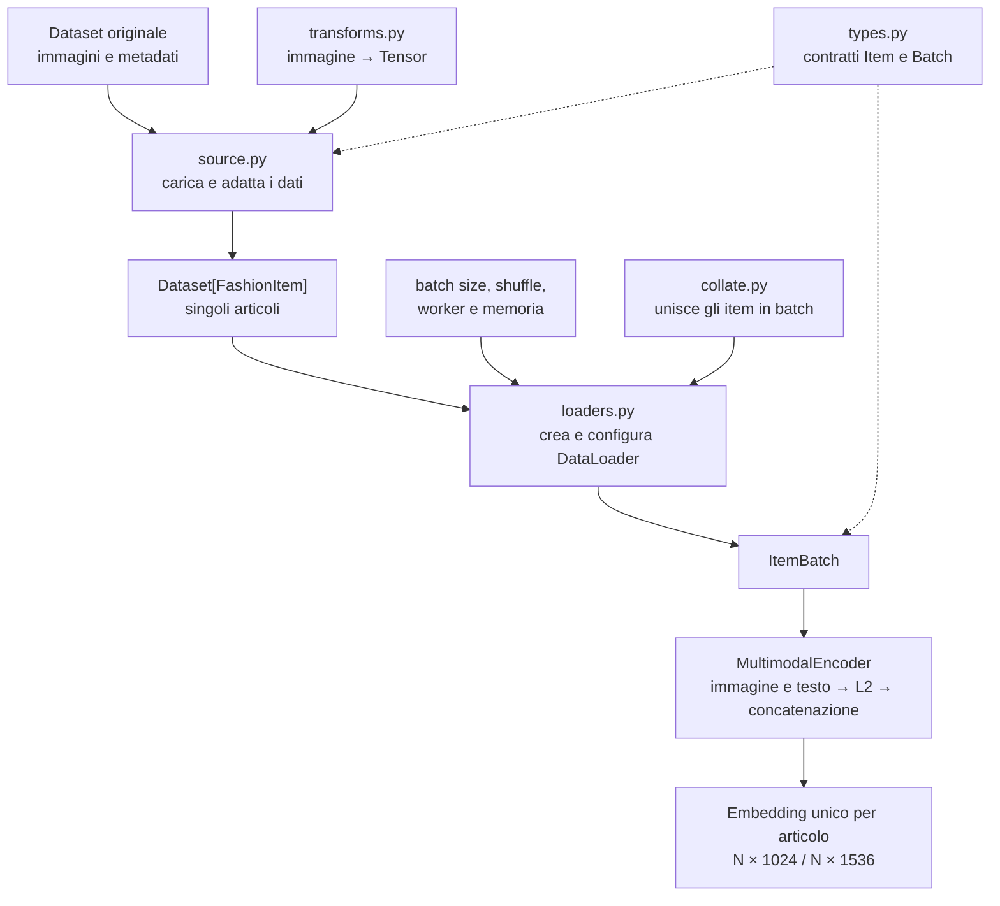

# Dati e batching

## Indice

- [File](#file)
- [Flusso complessivo](#flusso-complessivo)
- [Responsabilità dei componenti](#responsabilità-dei-componenti)
- [`types.py`: contratti dei dati](#typespy-contratti-dei-dati)
- [`source.py`: interfaccia delle sorgenti](#sourcepy-interfaccia-delle-sorgenti)
- [`transforms.py`: preprocessing delle immagini](#transformspy-preprocessing-delle-immagini)
- [`collate.py`: costruzione dei batch](#collatepy-costruzione-dei-batch)
- [`loaders.py`: configurazione dei DataLoader](#loaderspy-configurazione-dei-dataloader)
- [Outfit etichettati e negativi per retrieval](#outfit-etichettati-e-negativi-per-retrieval)
- [Dataset disponibili](#dataset-disponibili)
- [Dataset Polyvore](#dataset-polyvore)

## File

| File | Responsabilità |
|---|---|
| `__init__.py` | Espone l’API pubblica del package `data`. |
| `categories.py` | Definisce l'ordine comune delle 11 categorie, condiviso con le query del modello. |
| `types.py` | Definisce item e batch condivisi. |
| `source.py` | Definisce source, split, richieste e registry indipendenti dal dataset concreto. |
| `transforms.py` | Prepara le immagini per FashionCLIP o Marqo FashionSigLIP. |
| `collate.py` | Unisce gli esempi e li converte nell’input pubblico del modello. |
| `loaders.py` | Configura i `DataLoader` per singoli articoli e outfit etichettati. |
| `polyvore/` | Interpreta risorse e identificatori di Polyvore Outfits. |

## Flusso complessivo



| Componente | Responsabilità | Output |
|---|---|---|
| `transforms.py` | Converte e normalizza immagini nel formato richiesto dall’encoder. | `Tensor [3, H, W]` |
| `types.py` | Definisce contratti comuni per item e batch. | `FashionItem`, `OutfitItem` e `ItemBatch` |
| `source.py` | Carica il dataset originale e adatta i dati ai tipi comuni del progetto. | `Dataset[FashionItem]` |
| `loaders.py` | Decide come leggere più esempi: batch size, shuffle, worker e memoria. | `DataLoader` |
| `collate.py` | Unisce gli esempi letti dal loader e costruisce un batch di articoli. | `ItemBatch` |

## Responsabilità dei componenti

Il modulo dati acquisisce e interpreta le risorse, applica il preprocessing e
costruisce batch. Non contiene logica di ottimizzazione e non decide come
calcolare loss o metriche.

Il modello non scarica dati e non usa direttamente un `DataLoader`. È il
chiamante che legge un batch e passa immagini e descrizioni ai rispettivi
encoder.

Il download avviene durante la costruzione della pipeline. `Dataset.__getitem__`
legge soltanto risorse già disponibili in locale o nella cache Hugging Face.

## `types.py`: contratti dei dati

Definisce il linguaggio comune tra cataloghi, dataset, `DataLoader` e modello.
Se in futuro viene aggiunto un dataset diverso da Polyvore, può produrre gli
stessi tipi senza richiedere modifiche al modello.

| Concetto | Contenuto |
|---|---|
| `FashionItem` | Un articolo con ID, immagine trasformata, descrizione, categoria e sottocategoria. |
| `OutfitItem` | Immagine e testo insieme, oppure un embedding precomputato monodimensionale. |
| `ItemBatch` | Articoli indipendenti con ID e categorie nello stesso ordine. |
| `OutfitExample` | Un outfit, etichetta 0/1 e un gruppo di negativi per ogni capo. |
| `OutfitBatch` | Outfit e negativi di lunghezza variabile, etichette `[B]` e maschera `[B, 11]`. |

### Esempio di input e output

Valori illustrativi passati a `FashionItem`:

```text
Input
  item_id:      "132621870"
  image:        Tensor float32 [3, 224, 224]
  description:  "white cotton shirt"
  category:     "tops"

Output
  FashionItem che rappresenta un articolo valido e completo
```

Una sequenza di `FashionItem` viene convertita da `collate_items` in un
`ItemBatch`. ID, descrizione e categoria non possono essere vuoti; l’immagine
deve avere tre canali, tipo floating point e valori finiti.

Se l’immagine avesse forma `[224, 224]` o la descrizione fosse vuota, non
verrebbe prodotto alcun oggetto valido: il tipo segnalerebbe l’errore.

`OutfitItem` è definito in `data.types` e valida che siano presenti immagine
e testo insieme oppure un embedding. `ItemBatch` conserva `model_items`,
`item_ids` e `categories`; `as_single_item_outfits()` raggruppa ogni input
in una tupla contenente un solo item.

### Idea generale

`types.py` non legge file e non conosce la struttura di Polyvore. Definisce
invece il formato comune con cui le diverse parti del progetto si scambiano i
dati. È simile a un vocabolario condiviso: il dataset produce oggetti con una
forma nota, la collate li raggruppa e il chiamante sa cosa riceverà.

Il passaggio concettuale è questo:

1. il dataset legge **un articolo** dalla sorgente;
2. lo rappresenta come `FashionItem`;
3. la collate raccoglie più articoli e costruisce **un batch**;
4. il chiamante usa quel batch senza dover conoscere il formato originale dei
   file.

Questa separazione mantiene indipendenti le responsabilità:

- il dataset decide come leggere un singolo esempio;
- la collate decide come raggruppare più esempi;
- il chiamante decide come passare immagini e descrizioni agli encoder.

Il dataset non deve quindi conoscere il batch size, il modello o la strategia
di ottimizzazione. Allo stesso modo, il chiamante non deve sapere se i dati
arrivano da JSON, Parquet o da un futuro dataset diverso da Polyvore.

### Pinning della memoria

Il pinning non cambia il significato o il contenuto del batch. È soltanto
un’ottimizzazione del trasferimento dei tensori dalla memoria principale alla
GPU. Quando `pin_memory=True`, il `DataLoader` prepara anche i tensori contenuti
nei batch personalizzati per rendere più efficiente questo trasferimento. Su CPU
può essere lasciato disattivato.

## `transforms.py`: preprocessing delle immagini

Definisce il contratto generale `immagine PIL → tensore` e fornisce le transform
coerenti con i checkpoint degli encoder visuali. Non legge dataset, non
conosce item o outfit e non decide quale encoder usare: la transform viene
scelta quando si costruisce il loader.

La transform è scelta esplicitamente perché dipende dall’encoder visuale:

| Encoder | Preprocessing |
|---|---|
| FashionCLIP | Usa l’image processor associato al checkpoint scelto. |
| Marqo FashionSigLIP | `build_marqo_fashion_siglip_transform()` usa `AutoProcessor` con `trust_remote_code=True`, RGB e immagini `224 × 224`. |
| Encoder personalizzato | Può ricevere una transform compatibile fornita dall’esterno. |

### Esempio di input e output

```text
Input
  Immagine PIL RGB, dimensione 640 × 480

Transform FashionCLIP
  image processor del checkpoint → resize, crop, tensore e normalizzazione pixel

Output
  Tensor float32 [3, 224, 224]
```

Con FashionCLIP la dimensione e la normalizzazione dei pixel sono quelle
richieste dall’image processor del checkpoint. La normalizzazione L2 degli
embedding avviene nel modello, dopo la codifica.

Il catalogo converte sempre l’immagine in RGB prima di applicare la transform.
La stessa pipeline può quindi includere anche operazioni di preprocessing del
package `preprocessing`, purché alla fine restituisca un tensore `[3, H, W]`.

Nel modulo `model` sono presenti FashionCLIP e Marqo FashionSigLIP.
Lo script [precompute_embeddings](../scripts/README.md#precomputare-gli-embedding)
seleziona la transform coerente con il backend e salva gli embedding su disco.

## `collate.py`: costruzione dei batch

È il ponte tra gli esempi restituiti dai dataset e l’API del modello. Riceve una
lista di articoli, preserva identificatori e categorie, converte ogni
`FashionItem` in `OutfitItem` e produce un `ItemBatch`.

| Flusso | Risultato concettuale |
|---|---|
| Item | Un gruppo di articoli e una vista come outfit composti da un solo item. |

### Esempio di input e output

```text
Input di collate_items
  FashionItem i1: immagine, descrizione, categoria tops
  FashionItem i2: immagine, descrizione, categoria shoes

Output
  ItemBatch
  item_ids:    (i1, i2)
  categories:  (tops, shoes)
  model_items: (OutfitItem(image, text), OutfitItem(image, text))
```

La collate non combina le immagini in un unico tensore rettangolare e non crea
padding. Il chiamante usa `torch.stack` sulle immagini per ottenere il batch
`[N, 3, H, W]` dell’encoder visuale e raccoglie i testi in una sequenza per
l’encoder testuale. Una lista vuota viene rifiutata.

## `loaders.py`: configurazione dei DataLoader

`loaders.py` crea i `DataLoader` PyTorch per gli articoli. Riceve un dataset,
sceglie `collate_items` e applica batch size, shuffle e impostazioni dei worker.
Il risultato è un iteratore di `ItemBatch` pronti per il progetto.

Le factory accettano qualsiasi dataset che restituisca i `FashionItem` condivisi.
Creazione e lettura del dataset concreto appartengono a `DatasetSource`.

`LoaderConfig` raccoglie batch size, numero di worker, pinning, worker
persistenti, eliminazione dell'ultimo batch incompleto e seed. Richiede valori
coerenti, per esempio worker persistenti solo quando è presente almeno un
worker.

### Componenti passati al DataLoader

`loaders.py` non svolge da solo tutte le operazioni. Quando crea un
`DataLoader`, gli passa oggetti e funzioni definiti negli altri file:

| Parametro del DataLoader | Provenienza | Ruolo |
|---|---|---|
| `dataset` | Dataset restituito da una source oppure chiamante esterno | Restituisce un singolo `FashionItem` quando riceve un indice. |
| `collate_fn` | `collate.py` | Converte una lista di articoli in `ItemBatch`. |
| `batch_size`, worker, shuffle e altre opzioni | `LoaderConfig` e argomenti della factory | Controllano come gli esempi vengono letti e raggruppati. |

Il loader item resta ordinato per impostazione predefinita, utile quando le
feature devono essere associate in modo riproducibile agli `item_id`. Lo shuffle
può essere attivato esplicitamente.

`loaders.py` costruisce la pipeline ma non esegue il training: non crea modelli,
optimizer, loss o checkpoint.

### Esempio di input e output

```text
Input
  Dataset di 1.000 FashionItem
  LoaderConfig(batch_size=32, num_workers=4, pin_memory=True)
  shuffle=True

Output della factory
  DataLoader configurato con la collate_items

Output di una sua iterazione
  ItemBatch con al massimo 32 articoli
  item_ids, categories e model_items nello stesso ordine
```

La factory restituisce il `DataLoader`, non tutti i dati caricati in memoria.
Gli esempi vengono richiesti al dataset batch dopo batch. Source concreta riceve
subset, split, transform, token e cache; loader risultante usa sempre stesso
contratto pubblico.

`create_item_loader` accetta un dataset già costruito.
`build_polyvore_item_loader`, disponibile in `data.loaders`, risolve anche le
risorse Polyvore e crea catalogo e dataset prima del loader.

## `source.py`: interfaccia delle sorgenti

`source.py` definisce l'API comune tra progetto e dataset. I chiamanti
usano questa interfaccia per chiedere i dati necessari:

```text
«Dammi gli articoli dello split train»
```

`get_dataset_source` seleziona adapter corretto. Nel caso attuale restituisce
`PolyvoreSource`, adapter che legge file Polyvore e li converte nei tipi comuni
del progetto.

```text
chiamante/script
            ↓
API DatasetSource
            ↓
adapter PolyvoreSource
            ↓
tipi comuni del progetto
```

Workflow dipendono solo dall'interfaccia `DatasetSource`. Dettagli specifici,
come nomi dei file, download e parsing, restano dentro adapter. Per supportare
altro dataset basta creare e registrare nuovo adapter dentro `data`.

### Elementi principali

| Elemento | Cosa fa |
|---|---|
| `DatasetRequest` | Dice quale subset, split, cartella, cache e token usare. |
| `DataSplit` | Identifica train, validation e test. |
| `DatasetDescriptor` | Descrive identità, varianti e root predefinita della sorgente. |
| `DatasetDownloadRequest` | Raccoglie destinazione e opzioni del download completo. |
| `IndexedDataset` | Contratto di una sequenza indicizzabile con lunghezza. |
| `DatasetSource` | Interfaccia che stabilisce quali dati ogni adapter deve fornire. |
| `get_dataset_source("polyvore")` | Seleziona `PolyvoreSource`. |
| `PolyvoreSource` | Adapter che legge Polyvore e restituisce tipi comuni. |

### Esempio

```python
from pathlib import Path

from data import (
    DataSplit, DatasetRequest, build_fashion_clip_transform, get_dataset_source,
)

source = get_dataset_source("polyvore")
request = DatasetRequest(
    subset="nondisjoint",
    split=DataSplit.TRAIN,
    root=Path("datasets/polyvore-outfits"),
)
dataset = source.item_dataset(request, build_fashion_clip_transform())
example = dataset[0]
```

Passaggi eseguiti:

1. `get_dataset_source` seleziona `PolyvoreSource`;
2. `DatasetRequest` indica dati richiesti;
3. `PolyvoreSource` trova e legge file Polyvore;
4. il catalogo associa immagini e metadata tramite `item_id`;
5. il risultato è un `FashionItem` generico.

```text
Output
  item_id:     "132621870"
  image:       Tensor float32 [3, H, W]
  description: "white cotton shirt"
  category:    "tops"
```

Il chiamante vede soltanto il contratto comune, senza conoscere i file di
origine. `loaders.py` trasforma poi questi articoli in batch.

## Outfit etichettati e negativi per retrieval

Un **esempio** contiene un outfit completo, la sua etichetta 0/1 e alcune
alternative per ciascun capo. Un **batch** raccoglie più esempi per elaborarli
insieme. Quindi `batch_size=8` significa fino a 8 outfit, ciascuno con i propri
capi, etichetta, negativi e maschera delle categorie.

I tipi definiti in [`types.py`](types.py) rappresentano questi tre livelli:

| Tipo | Che cosa rappresenta |
|---|---|
| `FashionItem` | Un singolo articolo, per esempio una maglietta. È usato sia per i capi dell'outfit sia per le alternative. |
| `OutfitExample` | Un singolo esempio del dataset: outfit, etichetta e negativi. Da questi capi viene ricavata anche la maschera. |
| `OutfitBatch` | Più esempi raggruppati, mantenendo allineati i loro dati. |

Per il training con seed, lo stesso file espone `SeedExample` (outfit,
prompt e seed selezionato) e `SeedTrainingBatch` (`OutfitBatch`, tuple di
prompt e seed). Questi tipi dati sono condivisi dal modello e dal training;
il modello non importa moduli di `training`.

### Il singolo capo: `FashionItem`

Ogni capo porta con sé i dati necessari per riconoscerlo e codificarlo:

| Campo | Tipo | Esempio o significato |
|---|---|---|
| `item_id` | `str` | ID del prodotto nel catalogo. |
| `image` | `Tensor \| None` floating point `[3, H, W]` | Immagine già trasformata per l'encoder, assente quando si usa la cache. |
| `description` | `str` | Descrizione del capo, per esempio `"white cotton T-shirt"`. |
| `category` | `str` | Una delle 11 categorie generali, per esempio `"tops"`. |
| `subcategory` | `str \| None` | ID della categoria specifica di Polyvore, per esempio `"21"`. Negli esempi di outfit è obbligatoria. |
| `embedding` | `Tensor \| None` floating point `[D_visual + D_text]` | Feature concatenate precomputate, prima della MLP item. |

Un `FashionItem` deve avere un'immagine oppure feature precomputate. Nel
training cached, `PolyvoreCatalog.get(item_id, embedding=features)` riusa i
metadati senza decodificare immagini. `PolyvoreOutfitDataset` accetta
`precomputed_embeddings`, una mappa ID-feature; `positive_only=True` filtra
i target generativi e `seed=...` fissa il campionamento dei negativi per
validation. Le impostazioni di default della pipeline dati restano raw e
mantengono entrambe le label. Vedere la [guida training](../training/README.md).

La categoria dice a quale gruppo appartiene il capo; la sottocategoria lo
descrive a un livello più specifico. `subcategory` conserva il `category_id`
originale come stringa. Per usarlo come target della classificazione
fine-grained occorre una mappatura fissa da questi ID agli indici della testa,
uguale per training, validation e test.

`OutfitItem`, presente nello stesso file, è il formato di input del modello:
contiene immagine e testo oppure un embedding. I capi di `OutfitExample` e
`OutfitBatch` sono invece oggetti `FashionItem`, che conservano anche ID,
categoria e sottocategoria.

### Il singolo esempio: `OutfitExample`

`dataset[0]` restituisce un esempio con questi dati:

| Campo | Tipo | Significato |
|---|---|---|
| `outfit_id` | `str` | Riferimento alla riga sorgente, per esempio `"compatibility_train:1"`. |
| `items` | `tuple[FashionItem, ...]` | Tutti i capi che compongono l'outfit, nel loro ordine originale. |
| `label` | `int` | `1` se l'outfit è compatibile, `0` se è incompatibile. Riguarda l'intero outfit. |
| `negatives` | `tuple[tuple[FashionItem, ...], ...]` | Un gruppo di alternative per ciascun capo di `items`, nello stesso ordine. |
| `category_mask` | `Tensor` booleano `[11]` | Proprietà calcolata dai capi: indica quali categorie sono presenti. |

Per esempio, un outfit con maglietta, jeans e sneakers può essere rappresentato
così. I nomi indicano oggetti `FashionItem`; mostriamo due negativi per capo:

```text
OutfitExample
  outfit_id: "compatibility_train:1"
  items:     (maglietta_A, jeans_B, sneakers_C)
  label:     1

  negatives:
    per items[0], maglietta_A → (camicia_D, maglietta_E)   categoria tops
    per items[1], jeans_B     → (gonna_F, pantaloni_G)    categoria bottoms
    per items[2], sneakers_C  → (sandali_H, sneakers_I)   categoria shoes

  category_mask: presenza di tops, bottoms e shoes
```

Il collegamento è dato dalla posizione: `example.negatives[i]` contiene le
alternative per `example.items[i]`. Le alternative condividono la
**categoria generale** del capo; possono avere sottocategorie diverse.
Una camicia può quindi essere negativa rispetto a una maglietta.

I negativi sono candidati usati nel confronto della retrieval loss. Non fanno
parte dell'outfit e non hanno un'etichetta 0/1 propria. Un candidato diverso
dal target potrebbe comunque essere compatibile con l'outfit.

### La maschera delle 11 categorie

La maschera risponde alla domanda: **«Questa categoria compare nell'outfit?»**
Per l'esempio precedente vale:

```text
posizione   categoria       presente
    0       tops            True
    1       bottoms         True
    2       all-body        False
    3       outerwear       False
    4       shoes           True
    5       bags            False
    6       jewelry         False
    7       accessories     False
    8       sunglasses      False
    9       hats            False
   10       scarves         False
```

L'ordine è definito una sola volta in `data.OUTFIT_CATEGORIES` ed è condiviso
con `model.OUTFIT_CATEGORIES`. Il catalogo converte `jewellery`, usato da
Polyvore, in `jewelry`.

La maschera indica la presenza, senza contare i capi. Se un outfit contiene
collana e anello, entrambi restano in `items`, mentre la posizione `jewelry`
vale `True` una sola volta. La maschera considera soltanto i capi dell'outfit.

### Da più esempi a `OutfitBatch`

`collate_outfits` raccoglie gli esempi letti dal DataLoader e raggruppa i loro
campi. Indicando con `B` il numero di esempi, i dati del singolo esempio `b`
si leggono così:

| Accesso nel batch | Che cosa contiene per l'esempio `b` |
|---|---|
| `batch.outfit_ids[b]` | Il suo identificatore. |
| `batch.outfits[b]` | La sua tupla di `FashionItem`. |
| `batch.labels[b]` | La sua etichetta; tutte le etichette formano un `Tensor float32 [B]`. |
| `batch.negatives[b]` | I suoi gruppi di negativi, uno per capo. |
| `batch.category_mask[b]` | La sua maschera; tutte le maschere formano un `Tensor bool [B, 11]`. |

I tre indici dei negativi si leggono dall'esterno verso l'interno:

```python
batch.outfits[b][i]         # capo i dell'outfit b: FashionItem
batch.negatives[b][i]       # alternative per quel capo: tuple[FashionItem, ...]
batch.negatives[b][i][j]    # alternativa j per quel capo: FashionItem
```

Ogni outfit può avere un numero diverso di capi: per questo `outfits` e
`negatives` restano tuple annidate. Etichette e maschere hanno invece una forma
fissa e vengono raccolte in tensori.

### Esempio d'uso

```python
from pathlib import Path

from data import (
    DataSplit, DatasetRequest, FashionItem, LoaderConfig, OutfitBatch, OutfitExample,
    build_fashion_clip_transform, create_outfit_loader, get_dataset_source,
)

source = get_dataset_source("polyvore")
dataset = source.outfit_dataset(
    DatasetRequest(
        subset="nondisjoint",
        split=DataSplit.TRAIN,
        root=Path("datasets/polyvore-outfits"),
    ),
    build_fashion_clip_transform(),
    negatives_per_item=2,
)

example: OutfitExample = dataset[0]

loader = create_outfit_loader(
    dataset, config=LoaderConfig(batch_size=8), shuffle=True,
)
batch: OutfitBatch = next(iter(loader))

outfit: tuple[FashionItem, ...] = batch.outfits[0]
capo: FashionItem = outfit[0]
alternative: tuple[FashionItem, ...] = batch.negatives[0][0]

print(capo.category, capo.subcategory)
print(batch.labels[0])          # etichetta del primo outfit
print(batch.category_mask[0])   # maschera del primo outfit, bool [11]
```

### Regole da tenere presenti

- L'etichetta ufficiale descrive la compatibilità dell'outfit, non un voto
  estetico. Per supervisionare il retrieval di outfit corretti si usano gli
  esempi con `label == 1`; quelli con `label == 0` servono alla classificazione
  di compatibilità.
- `negatives_per_item` sceglie quante alternative campionare per capo; il
  valore predefinito è 4. Vengono ricampionate a ogni accesso, usando soltanto
  il catalogo dello split richiesto. Ogni gruppo contiene ID distinti ed
  esclude tutti i capi dell'outfit. Se le alternative non bastano, il dataset
  solleva `ValueError`.
- Più capi della stessa categoria restano tutti disponibili. Il chiamante
  deve decidere come usarli nelle loss che prevedono un solo positivo per
  categoria, con forma `[B, K, D]`.
- Per ripetere il sampling con `num_workers=0`, impostare `random.seed(...)`.
  Nei worker PyTorch inizializza `random`; `LoaderConfig.seed` controlla il
  generatore del DataLoader. I batch supportano anche `pin_memory`.

## Dataset disponibili

Il dataset item restituisce un articolo alla volta ed è pensato per analisi del
catalogo e codifica delle immagini e delle descrizioni. `PolyvoreItemDataset`
usa `PolyvoreCatalog` e può esporre tutti gli articoli oppure una sequenza
esplicita di ID, conservandone l’ordine.

## Dataset Polyvore

Formato delle risorse, varianti e split sono descritti in
[polyvore/README.md](polyvore/README.md).
