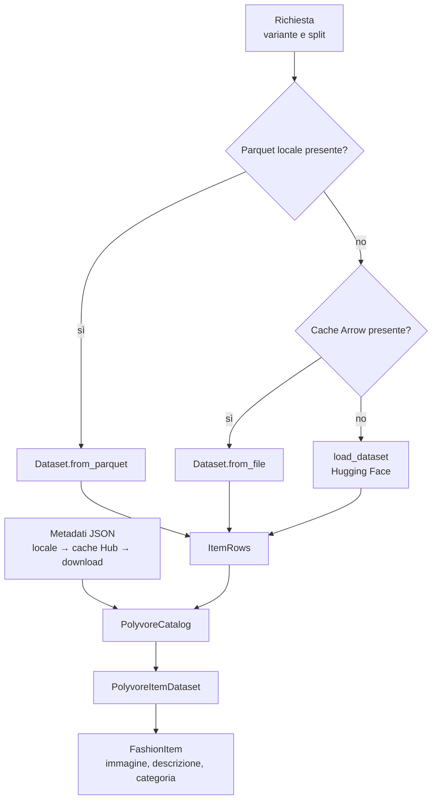

# Polyvore Outfits

## Indice

- [File](#file)
- [Dettaglio dei file: responsabilità, input e output](#dettaglio-dei-file-responsabilità-input-e-output)
- [Origine e accesso](#origine-e-accesso)
  - [Priorità delle sorgenti](#priorità-delle-sorgenti)
- [Varianti e split](#varianti-e-split)
- [Risorse del dataset](#risorse-del-dataset)
- [Identificatori e collegamenti](#identificatori-e-collegamenti)
- [Composizione di un item](#composizione-di-un-item)
- [Risorse scaricate](#risorse-scaricate)
- [Validazione e limiti](#validazione-e-limiti)

## File

| File | Responsabilità |
|---|---|
| `__init__.py` | Espone l’API pubblica del sottopackage Polyvore. |
| `download.py` | Cerca risorse locali/cache e scarica soltanto quelle mancanti. |
| `source.py` | Implementa `DatasetSource` e nasconde dettagli Polyvore ai workflow. |
| `rows.py` | Definisce il contratto strutturale minimo delle righe item. |
| `catalog.py` | Collega ogni `item_id` a immagine, descrizione e categoria. |
| `item_dataset.py` | Restituisce singoli articoli. |

## Dettaglio dei file: responsabilità, input e output

Gli esempi seguenti usano valori ridotti, ma rispettano il formato delle
risorse reali.


#### Esempio di input e output

| Input | Output |
|---|---|
| Importazione di `PolyvoreCatalog` da `data.polyvore`. | La classe pubblica definita in `catalog.py`. |
| Importazione di varianti, split o dataset. | I relativi tipi senza dover conoscere il file interno. |

### `download.py`

Conosce la sorgente Hugging Face e decide quali risorse servono in base a
variante e split. Scarica soltanto il necessario, riusa la cache e verifica che
le righe degli item contengano almeno `item_id` e immagine e che i file richiesti
esistano.

Non interpreta outfit, non applica transform e non costruisce dataset o
batch. Il suo risultato è un contenitore di risorse già localizzate e
verificate, che verrà passato agli altri componenti.

#### Esempio di input e output

```text
Input
  task:       items
  variant:    disjoint
  split:      train
  token:      token Hugging Face configurato

Output
  PolyvoreResources
  item_rows:     righe con item_id e immagine
  metadata_path: polyvore_item_metadata.json
```

Il risultato contiene dati e percorsi verificati, non un `Dataset` o un batch.

### `catalog.py`

È il punto di collegamento tra le diverse sorgenti che descrivono un articolo.
Indicizza le righe immagine tramite `item_id`, legge i metadata e applica la
transform scelta. Produce così un `FashionItem` uniforme, indipendentemente da
come l’immagine era rappresentata nella sorgente.

Espone inoltre `load_outfit_token_index` per costruire la mappa tra token
`set_id_index` e `item_id` usando un file degli outfit fornito dal chiamante. Conserva soltanto descrizione e categoria degli item presenti
nello split, evitando di mantenere in memoria tutto il metadata globale.

#### Esempio di input e output

```text
Input
  item_id: "132621870"
  riga immagine: image associata a "132621870"
  metadata: title="white shirt", semantic_category="tops"
  transform: immagine PIL → Tensor [3, 224, 224]

Output
  FashionItem
  item_id:      "132621870"
  image:        Tensor float32 [3, 224, 224]
  description:  "white shirt"
  category:     "tops"
```

Lo stesso file traduce anche un token come `199244701_1` nell’`item_id`
corrispondente usando il file degli outfit.

### `item_dataset.py`

Espone il catalogo come sequenza di singoli articoli. Riceve un indice e
restituisce il `FashionItem` corrispondente; opzionalmente può limitare la vista
a una lista specifica di `item_id`.

Serve per elaborare ogni prodotto indipendentemente dagli outfit, per esempio
durante analisi del catalogo o codifica degli embedding. Il raggruppamento
in batch appartiene al modulo `data`.

#### Esempio di input e output

```text
Input
  catalogo con item [i1, i2, i3]
  indice richiesto: 1

Output
  FashionItem relativo a i2
```

Una sequenza opzionale di ID può limitare o riordinare gli articoli esposti dal
dataset.

## Origine e accesso

La sorgente usata è il dataset Hugging Face
[`mvasil/polyvore-outfits`](https://huggingface.co/datasets/mvasil/polyvore-outfits).
Le righe Hugging Face forniscono immagini e `item_id`; file separati forniscono
testo, categorie e struttura degli outfit.

Il repository è gated: occorre accettare le condizioni indicate nella dataset
card e configurare un token Hugging Face.



### Priorità delle sorgenti

Ogni risorsa viene cercata in quest'ordine:

1. cartella `datasets/polyvore-outfits/`, o percorso `DatasetRequest.root`;
2. cache Hugging Face locale, predefinita o scelta con `--cache-dir`;
3. repository Hugging Face, soltanto quando la risorsa manca nelle prime due.

La cartella locale può contenere anche solo parte del dataset. I parquet
seguono `data/<variant>/<split>.parquet`; i metadata mantengono i
percorsi del repository `mvasil/polyvore-outfits`.

Comandi PowerShell/Linux e flag di download stanno solo nella
[guida degli script](../../scripts/README.md#download-polyvore).

## Varianti e split

| Variante | Separazione |
|---|---|
| `nondisjoint` | Gli outfit sono separati, ma lo stesso item può comparire in split differenti. |
| `disjoint` | Gli item di training, validation e test non si sovrappongono. |

La variante disjoint misura meglio la generalizzazione verso articoli mai visti.
La scelta non modifica il formato degli esempi o dei batch.

Entrambe le varianti prevedono gli split `train`, `validation` e `test`. Nei
Parquet si usa `validation.parquet`; i file della struttura degli outfit usano
l’abbreviazione `valid.json`.
Training serve per ottimizzare, validation per scegliere configurazioni e
checkpoint, test per la valutazione finale.

## Risorse del dataset

| Risorsa | Contenuto | Collegamento principale |
|---|---|---|
| Parquet esposti come righe Hugging Face | Una coppia `item_id` e immagine per articolo. | `item_id` |
| `<variant>/<split>.json` | Outfit con `set_id`, posizione e `item_id` degli articoli. | `set_id` + `index` |
| `polyvore_item_metadata.json` | Titolo, descrizione, nome URL e categoria degli articoli. | `item_id` |

Le immagini non si trovano nel file dei metadata. Allo stesso modo, i token
degli outfit non contengono né pixel né testo: sono riferimenti da
risolvere attraverso la struttura degli outfit.

Il caricamento degli articoli usa soltanto righe immagine e metadata. La
struttura degli outfit può essere letta separatamente tramite l’helper
`load_outfit_token_index`; non è richiesta da `item_dataset`.

## Identificatori e collegamenti

Polyvore usa tre identificatori distinti:

| Identificatore | Significato |
|---|---|
| `set_id` | Identifica un outfit. |
| `index` | Indica la posizione originale di un articolo nell’outfit. |
| `item_id` | Identifica il prodotto reale e collega immagine e metadata. |

Un outfit nel file dello split ha concettualmente questa forma:

```json
{
  "set_id": "199244701",
  "items": [
    {"index": 1, "item_id": "132621870"},
    {"index": 2, "item_id": "153967122"}
  ]
}
```

L’helper `load_outfit_token_index` usa un token ottenuto unendo `set_id` e `index`. Per esempio,
`199244701_1` viene risolto nell’`item_id` `132621870`. A quel punto il catalogo
recupera l’immagine dalle righe Hugging Face e il testo dai metadata.

Il token identifica una posizione in uno specifico outfit; `item_id` identifica
invece l’articolo reale. Token diversi possono quindi riferirsi allo stesso
prodotto.

## Composizione di un item

Il catalogo costruisce ogni articolo combinando tre sorgenti:

| Campo prodotto | Sorgente |
|---|---|
| Immagine | Campo `image` della riga Hugging Face, poi conversione RGB e transform. |
| Descrizione | `title` o `url_name`, eventualmente uniti a `description`. |
| Categoria | `semantic_category`; in assenza, `category_id`. |

Se il testo manca completamente viene usata la descrizione `fashion item`; se
manca la categoria viene usato `unknown`. Del metadata globale vengono
conservati soltanto descrizione e categoria degli item presenti nello split,
riducendo l’uso di memoria.

Le immagini possono essere già decodificate, rappresentate come byte o riferite
da un percorso locale fornito da Hugging Face. Non vengono scaricate da URL
esterni durante l’iterazione del dataset.

## Risorse scaricate

| Richiesta | Risorse richieste |
|---|---|
| Articoli | Righe immagine dello split e metadata globali. |
| Solo metadata | `polyvore_item_metadata.json`, con `include_items=False` e `include_metadata=True`. |

`download_polyvore_resources` mantiene i parametri `task="items"`, `variant`,
`split`, `token`, `cache_dir`, `dataset_root`, `include_items` e
`include_metadata`. `PolyvoreTask` espone `ITEMS`; `PolyvoreResources` contiene
`item_rows` e `metadata_path`.

La risoluzione mantiene l’ordine file locali, cache Hugging Face, download dei
soli file mancanti. Risoluzione e verifica avvengono prima della creazione del
dataset; l’accesso a un singolo articolo non effettua operazioni di rete.

`PolyvoreSource.download` e lo script di download scaricano invece il repository
completo mantenendone la struttura originale.

## Validazione e limiti

Il caricamento controlla che immagini e `item_id` siano presenti e che i file
richiesti esistano. Il catalogo rifiuta ID duplicati o vuoti; il dataset verifica
che gli ID richiesti appartengano al catalogo dello split selezionato.

JSON non validi, immagini non decodificabili e articoli sconosciuti producono
errori espliciti. L’helper degli outfit verifica che ogni elemento abbia
`set_id`, `index` e `item_id` coerenti e che un token non identifichi prodotti
diversi.

Il catalogo descrive i dati grezzi e trasformati, ma non salva embedding. Le
feature sono prodotte dagli encoder di `model.multimodal_representation` e
rimangono a disposizione del chiamante.
