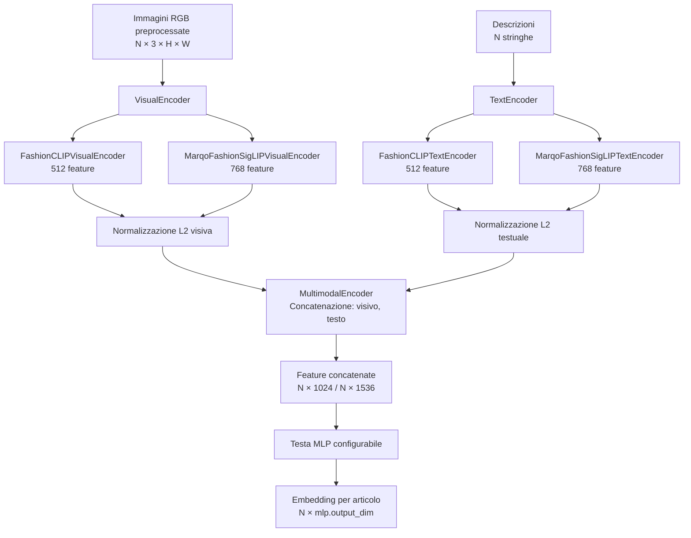

# Model

## Moduli

| Modulo | Responsabilità | Documentazione |
|---|---|---|
| `config.py` | Default del modello: backbone, MLP, LoRA, loss e percorsi CP. | [Configurazione](#default-del-modello) |
| `outfit/` | Query di categoria, encoder seed, generazione, modello completo e builder. | [Modello completo](#modello-completo-e-dimensioni-delle-mlp) |
| `compatibility/` | Download di codice/pesi OutfitTransformer e scorer CP congelato. | [Caricamento CP](#caricamento-automatico-del-cp) |
| `multimodal_representation` | Crea embedding FashionCLIP o Marqo FashionSigLIP, li normalizza L2, concatena visivo e testo e applica la testa MLP. | [README](multimodal_representation/README.md) |
| `mlp` | Crea MLP indipendenti con input, output e dimensioni dei layer nascosti configurabili. | [README](mlp/README.md) |
| `llm` | Contestualizza prompt e 11 query usando Qwen3 e restituisce soltanto gli hidden state delle query. | [README](llm/README.md) |
| `losses` | Calcola retrieval, CP, presenza, sottocategoria e Composition Loss. | [README](losses/README.md) |

```text
model/
├── config.py
├── outfit/                   # Query, seed, forward e costruzione del modello
│   ├── build.py
│   ├── category_query_embeddings.py
│   ├── outfit_seed_encoder.py
│   ├── seed_to_outfit.py
│   └── text2outfit.py
├── compatibility/            # CP OutfitTransformer
│   ├── download.py
│   └── scorer.py
├── llm/
├── multimodal_representation/
├── mlp/
└── losses/
```

Gli import pubblici restano `from model import build_model, Text2OutfitModel, ...`.

## Caricamento automatico del CP

Il builder usa [`compatibility/download.py`](compatibility/download.py) per
riutilizzare codice e pesi locali. Se il codice manca, scarica i soli file
Python del package `model/` dal repository
[FlorindoDev/OutfitTransformer](https://github.com/FlorindoDev/OutfitTransformer).
I pesi provengono da
[FlorindoDev/OutfitTransformer-weights](https://huggingface.co/FlorindoDev/OutfitTransformer-weights):
scarica unicamente il `best.pt` CP selezionato, senza epoche né checkpoint CIR.

I default in `ModelConfig` sono:

| Parametro | Default |
|---|---|
| `cp_repo` | `.cache/outfit_transformer`: cartella del codice scaricato |
| `cp_checkpoint` | `None`: cerca nel repository locale, poi nella cache Hub, infine scarica |
| `cp_source_url` | Archivio GitHub del branch `main-branch` |
| `cp_weights_repo` | `FlorindoDev/OutfitTransformer-weights` |
| `cp_weights_file` | `checkpoints/nondisjoint/cp_precomputed-flashionclip/best.pt` (FashionCLIP; con SigLIP specificare il relativo CP) |
| `cp_cache` | `.cache/huggingface-cp` |

Per preparare solo il CP, senza caricare Qwen o avviare il training:

```powershell
python -m model.compatibility
```

`--cp-repo` e `--cp-checkpoint` permettono di usare codice e pesi già presenti.
Un checkpoint locale esplicito mancante e una directory codice esistente ma
non valida producono un errore; i file locali non vengono sostituiti.
Il loader [`scorer.py`](compatibility/scorer.py) ricostruisce l'architettura,
carica rigorosamente tutti i pesi CP e li mantiene congelati, conservando il
gradiente rispetto agli embedding generati.

## Default del modello

[`config.py`](config.py) espone `ModelConfig` e `DEFAULT_MODEL_CONFIG`,
importabili anche da `model`, per architettura, backbone, LoRA e loss.
`TrainingConfig` e `DEFAULT_TRAINING_CONFIG` si trovano invece in
[`training/config.py`](../training/config.py), importabili anche da `training`.

| Iperparametro | Default |
|---|---|
| `category_embedding_dim` | `4096`: larghezza di ciascuna delle 11 query |
| `retrieval_dim` | `None`: uscita automatica `1024` per FashionCLIP / `1536` per SigLIP, condivisa da retrieval, MLP item e ingresso CP |
| `seed_hidden_dims` | `(512,)` |
| `retrieval_hidden_dims` | `(512,)` |
| `category_hidden_dims` | `(512,)` |
| `fine_grained_hidden_dims` | `(512,)` |
| `item_hidden_dims` | `(512,)` |
| `lora_rank` | `64` |
| `lora_alpha` | `128` |
| `lora_dropout` | `0.05` |
| `temperature` | `0.07` |
| `loss_weights` | `(1.0, 1.0, 1.0)`: retrieval, CP, composizione |

Ogni tupla elenca le larghezze dei soli layer nascosti: `(1024, 512)` crea due
layer nascosti; `()` crea una proiezione lineare. Le MLP usano ReLU fra i layer
nascosti e un'uscita lineare, senza normalizzazione aggiuntiva.

Il config separa LLM, embedding di categoria, encoder, le cinque famiglie di MLP,
LoRA e loss. Accanto a ogni MLP riporta il percorso completo
`ingresso -> layer nascosti -> uscita`, con le dimensioni dei default.
`category_embedding_dim` deve coincidere con `hidden_size` del LLM selezionato:
il builder verifica questa condizione prima di creare query, LoRA e MLP.

Nel medesimo file si configurano anche nomi/cache dei backbone, precisione,
moduli bersaglio LoRA, gradient checkpointing, modalità del seed e percorsi CP.
In `training/config.py` si trovano epoche, learning rate, weight decay, batch
size, accumulo, clipping, campionamento, riproducibilità, dataset e output.
I flag CLI sovrascrivono i config per una singola esecuzione. `--hidden-dim N`
è una scorciatoia che imposta tutte e cinque le famiglie di MLP a un solo layer
nascosto largo `N`; per dimensioni diverse fra le MLP modificare il config.

## Modello completo e dimensioni delle MLP

[`build_model()`](outfit/build.py) è l'unico punto di costruzione dell'architettura
completa. Crea backbone, LoRA, query, MLP del seed, 33 teste di categoria,
rappresentazione item e scorer CP senza adattatore. Il risultato è un
`Text2OutfitModel`; il modulo `training` prepara dati e loader e gestisce il
ciclo di addestramento, senza istanziare reti o scegliere dimensioni dei layer.

Con i default Qwen3 Embedding 8B (`H=4096`), FashionCLIP (`V=T=512`) e uno
scorer CP con input `P=1024`, le MLP sono:

| MLP | Quante | Input → layer nascosti → output | Parametri per MLP |
|---|---:|---|---:|
| Seed | 1 | `512 → 512 → 4096` | 2.363.904 |
| Retrieval | 11 | `4096 → 512 → 1024` | 2.622.976 |
| Presenza | 11 | `4096 → 512 → 1` | 2.098.177 |
| Sottocategoria | 11 | `4096 → 512 → C_i` | `2.097.664 + 513 × C_i` |
| Item multimodale | 1 | `1024 → 512 → 1024` | 1.050.112 |

Sono **35 MLP** complessive. Le tre teste per categoria hanno pesi indipendenti.
`C_i` è il numero di sottocategorie della categoria `i`, letto dalla tassonomia.
Ogni conteggio include pesi e bias dei layer lineari; ReLU non aggiunge parametri.

Il builder legge `H` dall'LLM e verifica che corrisponda a
`category_embedding_dim` e legge `V/T` dagli encoder o dalla cache.
`resolved_retrieval_dim` sceglie `1024` con FashionCLIP e `1536` con SigLIP
quando `retrieval_dim` è `None`; un valore esplicito ha precedenza. Il builder
salva la dimensione effettiva in `model.config.retrieval_dim`.
Il checkpoint CP deve avere la stessa larghezza: il CP riceve direttamente
gli embedding generati e il caricamento rifiuta dimensioni incompatibili.
Cambiando LLM, impostare anche `category_embedding_dim` alla
larghezza del nuovo checkpoint. Con Marqo, `V=T=768`: seed e item partono quindi
rispettivamente da 768 e 1536 feature; item e retrieval escono a 1536,
usando un CP Marqo da 1536 indicato con `cp_checkpoint` o `cp_weights_file`.
Se una categoria non ha classi nella
tassonomia caricata, la sua testa ha una sola uscita inutilizzata.

Questa variante omette `W_cp`, presente nell'Eq. (4) del paper. Le teste
retrieval imparano direttamente uno spazio usato sia per il catalogo sia per
il CP congelato; la corrispondenza delle dimensioni non garantisce da sola
l'allineamento con le feature su cui il CP è stato addestrato.

`model.architecture()` restituisce le dimensioni e il numero di parametri
effettivi di ogni MLP. `model.architecture_summary()` li presenta in una
tabella leggibile, con totali del modello e dei parametri allenabili.
Il training stampa questa tabella e la salva in `architecture.txt`.

## Architettura



Le dimensioni indicate sono quelle dei checkpoint predefiniti; ogni encoder
espone la dimensione effettiva tramite `output_dim`.

## API pubblica

| Classe | Input | Output |
|---|---|---|
| `VisualEncoder` | Tensore `[N, 3, H, W]`. | Embedding visivi normalizzati L2 `[N, D]`. |
| `TextEncoder` | Sequenza di `N` descrizioni non vuote. | Embedding testuali normalizzati L2 `[N, D]`. |
| `FashionCLIPVisualEncoder` | Immagini preparate con `build_fashion_clip_transform`. | Feature visuali FashionCLIP. |
| `FashionCLIPTextEncoder` | Descrizioni; tokenizzazione inclusa. | Feature testuali FashionCLIP. |
| `MarqoFashionSigLIPVisualEncoder` | Immagini preparate con `build_marqo_fashion_siglip_transform`. | Feature visuali Marqo. |
| `MarqoFashionSigLIPTextEncoder` | Descrizioni; processor Marqo incluso. | Feature testuali Marqo. |
| `MultimodalEncoder` | Immagini e descrizioni dello stesso batch, oppure `precomputed=[N, mlp.input_dim]`. | Proiezione delle feature concatenate `[N, mlp.output_dim]`; MLP sempre allenabile. |
| `MLP` | Tensore `[..., input_dim]`; `hidden_dims` imposta larghezza e profondita. | Tensore `[..., output_dim]`, senza normalizzazione. |
| `OutfitSeedEncoder` | Immagine preprocessata `[3, H, W]` o batch `[N, 3, H, W]`. | Embedding del seed `[N, mlp.output_dim]`. |
| `CategoryQueryEmbeddings` | `embedding_dim` al costruttore; `batch_size` nel forward, default `1`. | Query apprendibili `[batch_size, 11, embedding_dim]`. |
| `LLM` / `Qwen3LLM` | Prompt e query `[B, 11, H]`; `H=4096` per Qwen3 Embedding 8B. | Hidden state finali delle 11 query `[B, 11, H]`, senza pooling. |
| `SeedToOutfitModel` | Prompt e un seed per esempio: immagine preprocessata oppure descrizione. | `SeedToOutfitOutput`: embedding retrieval, logits di presenza e logits di sottocategoria. |

Le stesse classi si importano da `model` e da
`model.multimodal_representation`:

```python
from model import FashionCLIPTextEncoder, FashionCLIPVisualEncoder, MultimodalEncoder
```

`MLP` si importa da `model` o `model.mlp`. La [guida MLP](mlp/README.md)
mostra come creare quattro reti con architetture diverse. Lo script
[`precompute_embeddings`](../scripts/README.md#precomputare-gli-embedding)
salva su disco gli input riutilizzabili durante l'addestramento.

Le loss si importano da `model.losses` o direttamente da `model`.
La [guida delle loss](losses/README.md) descrive formule, negativi, maschere,
formati dei target, gradienti e scelte rispetto al paper.

## Encoding del seed dell'outfit

`OutfitSeedEncoder`, in `model/outfit/outfit_seed_encoder.py`, compone il flusso
`immagine -> encoder visuale -> embedding visivo L2 -> MLP -> embedding seed`.
Riceve un `VisualEncoder` e un `MLP` gia costruiti, senza duplicarli. Si puo
passare direttamente `multimodal.visual_encoder` per condividere la stessa
istanza usata da `MultimodalEncoder`.

```python
import torch

from data import build_fashion_clip_transform
from model import FashionCLIPVisualEncoder, MLP, OutfitSeedEncoder
from preprocessing.image_loader import load_image_from_path

visual = FashionCLIPVisualEncoder(trainable=False)
seed_encoder = OutfitSeedEncoder(
    visual_encoder=visual,
    mlp=MLP(input_dim=visual.output_dim, output_dim=256, hidden_dims=[512, 256]),
).eval()

image = load_image_from_path("seed.jpg")
image_tensor = build_fashion_clip_transform()(image)
with torch.inference_mode():
    seed_embedding = seed_encoder(image_tensor)  # [1, 256]
```

L'input dell'MLP e il solo embedding visuale: 512 feature per FashionCLIP,
768 per Marqo, usando i checkpoint predefiniti. Non richiede testo. Per
Marqo passare `MarqoFashionSigLIPVisualEncoder` e preprocessare con
`build_marqo_fashion_siglip_transform`. La transform deve corrispondere al
checkpoint; tensore e modello devono trovarsi sullo stesso dispositivo.

Anche con una sola immagine l'output conserva la dimensione batch: `[1, D]`.
La dimensione in ingresso all'MLP viene verificata alla costruzione.
L'output dell'MLP resta lineare e non viene normalizzato ulteriormente.

L'MLP parte con pesi casuali e va addestrato. Il modulo conserva i gradienti
durante il training; con encoder congelato si addestra soltanto l'MLP.
`torch.inference_mode()` nell'esempio serve alla sola inferenza.

## Query apprendibili di categoria

`CategoryQueryEmbeddings`, in `model/outfit/category_query_embeddings.py`, crea una
tabella `nn.Embedding` con una query per ciascuna delle 11 categorie di
Text2Outfit. La dimensione viene passata dal config e deve corrispondere a
quella degli embedding d'ingresso dell'LLM.

```python
from model import CategoryQueryEmbeddings, DEFAULT_MODEL_CONFIG

queries = CategoryQueryEmbeddings(embedding_dim=DEFAULT_MODEL_CONFIG.category_embedding_dim)
embeddings = queries(batch_size=8)  # [8, 11, 4096]
categories = queries.categories
shoes = embeddings[:, categories.index("shoes"), :]
```

L'ordine, disponibile anche come costante `model.OUTFIT_CATEGORIES`, e:
`tops`, `bottoms`, `all-body`, `outerwear`, `shoes`, `bags`, `jewelry`,
`accessories`, `sunglasses`, `hats`, `scarves`.

Ogni categoria ha parametri propri, condivisi fra gli esempi del batch.
Il modulo usa l'inizializzazione casuale standard di `nn.Embedding`, senza
normalizzazione. I vettori vanno addestrati: acquistano significato tramite
le loss del modello in cui verranno inseriti. Il forward conserva i gradienti.
Si possono passare `queries.parameters()` a un optimizer e salvare/ripristinare
le query con `state_dict()`. `.to(device=..., dtype=...)` sposta il modulo;
l'output segue dispositivo e precisione dei pesi.

Il modulo produce soltanto le query iniziali e non richiede tokenizer o
checkpoint. L'inserimento nella sequenza, la maschera di attenzione e gli
hidden state contestualizzati `h_cat` sono gestiti da `model.llm.Qwen3LLM`.
Il suo backbone predefinito è `Qwen/Qwen3-Embedding-8B`; le query di categoria
possono vedersi reciprocamente. Vedere la [guida LLM](llm/README.md) per
contratto, esempio su GPU e gestione dei gradienti.

## Forward seed-to-outfit

`SeedToOutfitModel`, in [`seed_to_outfit.py`](outfit/seed_to_outfit.py), mette insieme
i moduli esistenti nel ramo di generazione della figura:

```text
Seed immagine -> VisualEncoder -> MLP -> un embedding seed
oppure seed testuale -> aggiunto al prompt
                                      |
Prompt + seed + 11 query -> LLM -> 11 hidden state
                                      |
                  +-------------------+-------------------+
                  |                   |                   |
            MLP retrieval       MLP presenza       MLP sottocategoria
            uno per categoria   uno per categoria  uno per categoria
                  |                   |                   |
             [B, 11, D]          [B, 11]          11 tensori [B, C_i]
```

Il costruttore riceve LLM, query e MLP già costruiti. `seed_encoder` serve
solo se si usano immagini. Tutte le teste ricevono `llm.output_dim` feature;
le 11 teste di retrieval devono produrre la stessa dimensione `D`, uguale
a quella degli embedding del catalogo con cui verranno confrontate.
Ogni categoria ha tre MLP proprie, con pesi indipendenti: retrieval,
presenza e sottocategoria. Ogni testa di presenza produce un solo logit
per la propria query. Ogni testa di
sottocategoria produce `C_i` logits, dove `C_i` è il numero di sottocategorie
di quella categoria: usa la stessa codifica dei target del training.

Nel [paper Text2Outfit](https://openaccess.thecvf.com/content/ICCV2025/papers/Zhai_Text2Outfit_Controllable_Outfit_Generation_with_Multimodal_Language_Models_ICCV_2025_paper.pdf),
la sezione 3.1 specifica le MLP di retrieval per categoria; la sezione 3.2
aggiunge le classificazioni di presenza e sottocategoria agli hidden state.
Il testo non esplicita se i classificatori condividano i pesi: questa
implementazione usa una testa separata per categoria anche per la presenza.

Per usare il modello completo, passa la tassonomia e il config al builder.
`subcategories` ? una tupla di 11 tuple di etichette, nell'ordine
`OUTFIT_CATEGORIES`, ricavata dai metadati della pipeline dati.

```python
from dataclasses import replace
import torch
from model import DEFAULT_MODEL_CONFIG, build_model

config = replace(
    DEFAULT_MODEL_CONFIG,
    seed_hidden_dims=(512,),
    item_hidden_dims=(1024, 512),
)
model = build_model(subcategories, config, device="cuda")
print(model.architecture_summary())

# Dopo aver caricato i pesi addestrati:
model.eval()
with torch.inference_mode():
    output = model(
        ["Outfit casual per una giornata estiva."],
        seed_texts=["Camicia di lino bianca."],
    )

output.retrieval_embeddings  # Tensor [B, 11, D]
output.category_logits      # Tensor [B, 11]
output.fine_grained_logits  # 11 Tensor [B, C_i]
```

`model(...)` esegue la generazione. `model.compute_losses(batch)` usa lo
stesso generatore e aggiunge i rami item/CP e le loss per il training.
`model.generator` espone il solo `SeedToOutfitModel` quando serve il ramo
superiore senza la rappresentazione degli item e lo scorer CP.

Il forward accetta un prompt `str` oppure una sequenza di `B` prompt.
`seed_images` ha forma `[3, H, W]` oppure `[B, 3, H, W]`; `seed_texts` è una
stringa oppure una sequenza di `B` descrizioni. Va fornita esattamente una
modalità. In alternativa alle immagini, `seed_features=[B, D_visual]` usa
feature visuali già precomputate attraversando la stessa MLP del seed.
`OutfitSeedEncoder` accetta queste feature con `precomputed=...`; il suo
encoder visuale può essere `None` quando si usa soltanto la cache.
Per le immagini usa la transform del `VisualEncoder` scelto.
Il seed immagine diventa un token dopo il prompt e prima delle query; il
seed testuale viene aggiunto come `Seed item: ...`. Qwen restituisce sempre
soltanto gli hidden state delle 11 query.

Ogni uscita mantiene l'ordine `model.categories`. I logits sono grezzi:
il forward non applica sigmoid, softmax, soglie o argmax. Non seleziona
articoli dal catalogo e non calcola loss né rappresentazioni multimodali
degli articoli. Non richiede label, negativi o maschere target del batch.

Le query e le MLP iniziano con pesi casuali: richiedono addestramento o il
caricamento di un checkpoint addestrato per produrre outfit significativi.
Il forward conserva i gradienti anche attraverso Qwen congelato e adatta
gli hidden state al dispositivo e dtype delle teste. Per il training usa
`model.train()` senza `torch.inference_mode()`; i pesi congelati dei backbone
mantengono le regole dei rispettivi moduli.

## Responsabilità e limiti

Il modulo riceve tensori e descrizioni già letti dalla pipeline dati. Non
dipende da Polyvore e non sceglie quali articoli caricare. I contratti dati
`FashionItem`, `OutfitItem` e `ItemBatch` restano nel package `data`.

Ogni encoder normalizza L2 il proprio embedding. `MultimodalEncoder` concatena
prima il visivo e poi il testo e applica la testa MLP configurabile. Verifica
che il numero di immagini e descrizioni coincida e che l'input dell'MLP abbia
dimensione pari alla somma delle due modalita. Il suo `output_dim` e quello
della testa MLP. Gli embedding precomputati sono le feature prima della testa.
FashionCLIP usa `trainable=False` per default; Marqo mantiene sempre il backbone
congelato. Dettagli, esempi e gestione del dispositivo sono nel
[README degli encoder](multimodal_representation/README.md).
