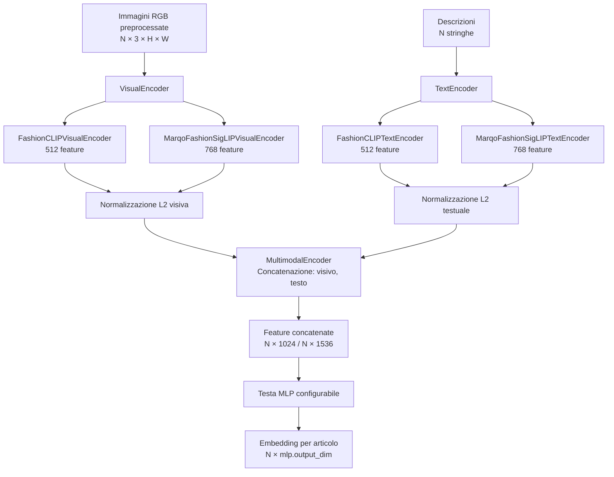

# Model

## Moduli

| Modulo | Responsabilità | Documentazione |
|---|---|---|
| `multimodal_representation` | Crea embedding FashionCLIP o Marqo FashionSigLIP, li normalizza L2, concatena visivo e testo e applica la testa MLP. | [README](multimodal_representation/README.md) |
| `mlp` | Crea MLP indipendenti con input, output e dimensioni dei layer nascosti configurabili. | [README](mlp/README.md) |
| `outfit_seed_encoder.py` | Codifica l'immagine seed con l'encoder visuale esistente e passa l'embedding a un MLP. | [Utilizzo](#encoding-del-seed-delloutfit) |

## Architettura



Le dimensioni indicate sono quelle dei checkpoint predefiniti; ogni encoder
espone la dimensione effettiva tramite `output_dim`.

## API pubblica

| Classe | Input | Output |
|---|---|---|
| `VisualEncoder` | Tensore `[N, 3, H, W]`. | Embedding visivi normalizzati L2 `[N, D]`. |
| `TextEncoder` | Sequenza di `N` descrizioni non vuote. | Embedding testuali normalizzati L2 `[N, D]`. |
| `FashionCLIPVisualEncoder` | Immagini preparate con `build_fashion_clip_transform`. | Feature visuali FashionCLIP. |
| `FashionCLIPTextEncoder` | Descrizioni; tokenizzazione inclusa. | Feature testuali FashionCLIP. |
| `MarqoFashionSigLIPVisualEncoder` | Immagini preparate con `build_marqo_fashion_siglip_transform`. | Feature visuali Marqo. |
| `MarqoFashionSigLIPTextEncoder` | Descrizioni; processor Marqo incluso. | Feature testuali Marqo. |
| `MultimodalEncoder` | Immagini e descrizioni dello stesso batch; testa `MLP` passata al costruttore. | Proiezione delle feature concatenate `[N, mlp.output_dim]`. |
| `MLP` | Tensore `[..., input_dim]`; `hidden_dims` imposta larghezza e profondita. | Tensore `[..., output_dim]`, senza normalizzazione. |
| `OutfitSeedEncoder` | Immagine preprocessata `[3, H, W]` o batch `[N, 3, H, W]`. | Embedding del seed `[N, mlp.output_dim]`. |

Le stesse classi si importano da `model` e da
`model.multimodal_representation`:

```python
from model import FashionCLIPTextEncoder, FashionCLIPVisualEncoder, MultimodalEncoder
```

`MLP` si importa da `model` o `model.mlp`. La [guida MLP](mlp/README.md)
mostra come creare quattro reti con architetture diverse. Lo script
[`precompute_embeddings`](../scripts/README.md#precomputare-gli-embedding)
salva su disco gli input riutilizzabili durante l'addestramento.

## Encoding del seed dell'outfit

`OutfitSeedEncoder`, in `model/outfit_seed_encoder.py`, compone il flusso
`immagine -> encoder visuale -> embedding visivo L2 -> MLP -> embedding seed`.
Riceve un `VisualEncoder` e un `MLP` gia costruiti, senza duplicarli. Si puo
passare direttamente `multimodal.visual_encoder` per condividere la stessa
istanza usata da `MultimodalEncoder`.

```python
import torch

from data import build_fashion_clip_transform
from model import FashionCLIPVisualEncoder, MLP, OutfitSeedEncoder
from preprocessing.image_loader import load_image_from_path

visual = FashionCLIPVisualEncoder(trainable=False)
seed_encoder = OutfitSeedEncoder(
    visual_encoder=visual,
    mlp=MLP(input_dim=visual.output_dim, output_dim=256, hidden_dims=[512, 256]),
).eval()

image = load_image_from_path("seed.jpg")
image_tensor = build_fashion_clip_transform()(image)
with torch.inference_mode():
    seed_embedding = seed_encoder(image_tensor)  # [1, 256]
```

L'input dell'MLP e il solo embedding visuale: 512 feature per FashionCLIP,
768 per Marqo, usando i checkpoint predefiniti. Non richiede testo. Per
Marqo passare `MarqoFashionSigLIPVisualEncoder` e preprocessare con
`build_marqo_fashion_siglip_transform`. La transform deve corrispondere al
checkpoint; tensore e modello devono trovarsi sullo stesso dispositivo.

Anche con una sola immagine l'output conserva la dimensione batch: `[1, D]`.
La dimensione in ingresso all'MLP viene verificata alla costruzione.
L'output dell'MLP resta lineare e non viene normalizzato ulteriormente.

L'MLP parte con pesi casuali e va addestrato. Il modulo conserva i gradienti
durante il training; con encoder congelato si addestra soltanto l'MLP.
`torch.inference_mode()` nell'esempio serve alla sola inferenza.

## Responsabilità e limiti

Il modulo riceve tensori e descrizioni già letti dalla pipeline dati. Non
dipende da Polyvore e non sceglie quali articoli caricare. I contratti dati
`FashionItem`, `OutfitItem` e `ItemBatch` restano nel package `data`.

Ogni encoder normalizza L2 il proprio embedding. `MultimodalEncoder` concatena
prima il visivo e poi il testo e applica la testa MLP configurabile. Verifica
che il numero di immagini e descrizioni coincida e che l'input dell'MLP abbia
dimensione pari alla somma delle due modalita. Il suo `output_dim` e quello
della testa MLP. Gli embedding precomputati sono le feature prima della testa.
FashionCLIP conserva il parametro `trainable`; Marqo conserva il backbone
congelato. Dettagli, esempi e gestione del dispositivo sono nel
[README degli encoder](multimodal_representation/README.md).
