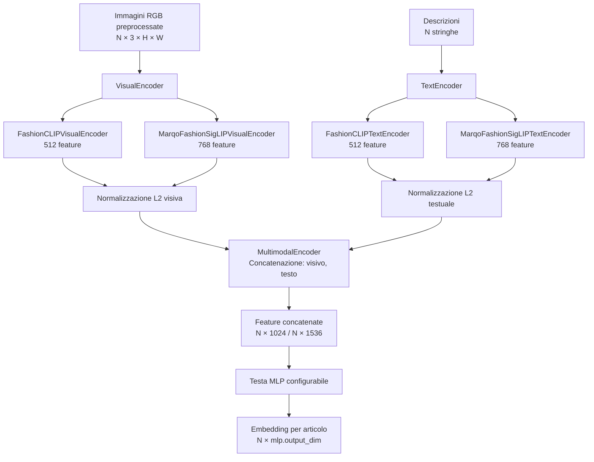

# Model

## Moduli

| Modulo | Responsabilità | Documentazione |
|---|---|---|
| `multimodal_representation` | Crea embedding FashionCLIP o Marqo FashionSigLIP, li normalizza L2, concatena visivo e testo e applica la testa MLP. | [README](multimodal_representation/README.md) |
| `mlp` | Crea MLP indipendenti con input, output e dimensioni dei layer nascosti configurabili. | [README](mlp/README.md) |
| `outfit_seed_encoder.py` | Codifica l'immagine seed con l'encoder visuale esistente e passa l'embedding a un MLP. | [Utilizzo](#encoding-del-seed-delloutfit) |
| `category_query_embeddings.py` | Crea le 11 query IMG_cat apprendibili esterne al tokenizer. | [Utilizzo](#query-apprendibili-di-categoria) |
| `llm` | Contestualizza prompt e 11 query usando Qwen3 e restituisce soltanto gli hidden state delle query. | [README](llm/README.md) |
| `seed_to_outfit.py` | Collega prompt, seed, query, LLM e teste di retrieval, presenza e sottocategoria. | [Utilizzo](#forward-seed-to-outfit) |
| `losses` | Calcola retrieval, CP, presenza, sottocategoria e Composition Loss. | [README](losses/README.md) |

## Architettura



Le dimensioni indicate sono quelle dei checkpoint predefiniti; ogni encoder
espone la dimensione effettiva tramite `output_dim`.

## API pubblica

| Classe | Input | Output |
|---|---|---|
| `VisualEncoder` | Tensore `[N, 3, H, W]`. | Embedding visivi normalizzati L2 `[N, D]`. |
| `TextEncoder` | Sequenza di `N` descrizioni non vuote. | Embedding testuali normalizzati L2 `[N, D]`. |
| `FashionCLIPVisualEncoder` | Immagini preparate con `build_fashion_clip_transform`. | Feature visuali FashionCLIP. |
| `FashionCLIPTextEncoder` | Descrizioni; tokenizzazione inclusa. | Feature testuali FashionCLIP. |
| `MarqoFashionSigLIPVisualEncoder` | Immagini preparate con `build_marqo_fashion_siglip_transform`. | Feature visuali Marqo. |
| `MarqoFashionSigLIPTextEncoder` | Descrizioni; processor Marqo incluso. | Feature testuali Marqo. |
| `MultimodalEncoder` | Immagini e descrizioni dello stesso batch; testa `MLP` passata al costruttore. | Proiezione delle feature concatenate `[N, mlp.output_dim]`. |
| `MLP` | Tensore `[..., input_dim]`; `hidden_dims` imposta larghezza e profondita. | Tensore `[..., output_dim]`, senza normalizzazione. |
| `OutfitSeedEncoder` | Immagine preprocessata `[3, H, W]` o batch `[N, 3, H, W]`. | Embedding del seed `[N, mlp.output_dim]`. |
| `CategoryQueryEmbeddings` | `embedding_dim` al costruttore; `batch_size` nel forward, default `1`. | Query apprendibili `[batch_size, 11, embedding_dim]`. |
| `LLM` / `Qwen3LLM` | Prompt e query `[B, 11, H]`; `H=4096` per Qwen3 Embedding 8B. | Hidden state finali delle 11 query `[B, 11, H]`, senza pooling. |
| `SeedToOutfitModel` | Prompt e un seed per esempio: immagine preprocessata oppure descrizione. | `SeedToOutfitOutput`: embedding retrieval, logits di presenza e logits di sottocategoria. |

Le stesse classi si importano da `model` e da
`model.multimodal_representation`:

```python
from model import FashionCLIPTextEncoder, FashionCLIPVisualEncoder, MultimodalEncoder
```

`MLP` si importa da `model` o `model.mlp`. La [guida MLP](mlp/README.md)
mostra come creare quattro reti con architetture diverse. Lo script
[`precompute_embeddings`](../scripts/README.md#precomputare-gli-embedding)
salva su disco gli input riutilizzabili durante l'addestramento.

Le loss si importano da `model.losses` o direttamente da `model`.
La [guida delle loss](losses/README.md) descrive formule, negativi, maschere,
formati dei target, gradienti e scelte rispetto al paper.

## Encoding del seed dell'outfit

`OutfitSeedEncoder`, in `model/outfit_seed_encoder.py`, compone il flusso
`immagine -> encoder visuale -> embedding visivo L2 -> MLP -> embedding seed`.
Riceve un `VisualEncoder` e un `MLP` gia costruiti, senza duplicarli. Si puo
passare direttamente `multimodal.visual_encoder` per condividere la stessa
istanza usata da `MultimodalEncoder`.

```python
import torch

from data import build_fashion_clip_transform
from model import FashionCLIPVisualEncoder, MLP, OutfitSeedEncoder
from preprocessing.image_loader import load_image_from_path

visual = FashionCLIPVisualEncoder(trainable=False)
seed_encoder = OutfitSeedEncoder(
    visual_encoder=visual,
    mlp=MLP(input_dim=visual.output_dim, output_dim=256, hidden_dims=[512, 256]),
).eval()

image = load_image_from_path("seed.jpg")
image_tensor = build_fashion_clip_transform()(image)
with torch.inference_mode():
    seed_embedding = seed_encoder(image_tensor)  # [1, 256]
```

L'input dell'MLP e il solo embedding visuale: 512 feature per FashionCLIP,
768 per Marqo, usando i checkpoint predefiniti. Non richiede testo. Per
Marqo passare `MarqoFashionSigLIPVisualEncoder` e preprocessare con
`build_marqo_fashion_siglip_transform`. La transform deve corrispondere al
checkpoint; tensore e modello devono trovarsi sullo stesso dispositivo.

Anche con una sola immagine l'output conserva la dimensione batch: `[1, D]`.
La dimensione in ingresso all'MLP viene verificata alla costruzione.
L'output dell'MLP resta lineare e non viene normalizzato ulteriormente.

L'MLP parte con pesi casuali e va addestrato. Il modulo conserva i gradienti
durante il training; con encoder congelato si addestra soltanto l'MLP.
`torch.inference_mode()` nell'esempio serve alla sola inferenza.

## Query apprendibili di categoria

`CategoryQueryEmbeddings`, in `model/category_query_embeddings.py`, crea una
tabella `nn.Embedding` con una query per ciascuna delle 11 categorie di
Text2Outfit. La dimensione e obbligatoria e deve corrispondere a quella degli
embedding d'ingresso dell'LLM che userai.

```python
from model import CategoryQueryEmbeddings

queries = CategoryQueryEmbeddings(embedding_dim=4096)  # Esempio di dimensione.
embeddings = queries(batch_size=8)  # [8, 11, 4096]
categories = queries.categories
shoes = embeddings[:, categories.index("shoes"), :]
```

L'ordine, disponibile anche come costante `model.OUTFIT_CATEGORIES`, e:
`tops`, `bottoms`, `all-body`, `outerwear`, `shoes`, `bags`, `jewelry`,
`accessories`, `sunglasses`, `hats`, `scarves`.

Ogni categoria ha parametri propri, condivisi fra gli esempi del batch.
Il modulo usa l'inizializzazione casuale standard di `nn.Embedding`, senza
normalizzazione. I vettori vanno addestrati: acquistano significato tramite
le loss del modello in cui verranno inseriti. Il forward conserva i gradienti.
Si possono passare `queries.parameters()` a un optimizer e salvare/ripristinare
le query con `state_dict()`. `.to(device=..., dtype=...)` sposta il modulo;
l'output segue dispositivo e precisione dei pesi.

Il modulo produce soltanto le query iniziali e non richiede tokenizer o
checkpoint. L'inserimento nella sequenza, la maschera di attenzione e gli
hidden state contestualizzati `h_cat` sono gestiti da `model.llm.Qwen3LLM`.
Il suo backbone predefinito è `Qwen/Qwen3-Embedding-8B`; le query di categoria
possono vedersi reciprocamente. Vedere la [guida LLM](llm/README.md) per
contratto, esempio su GPU e gestione dei gradienti.

## Forward seed-to-outfit

`SeedToOutfitModel`, in [`seed_to_outfit.py`](seed_to_outfit.py), mette insieme
i moduli esistenti nel ramo di generazione della figura:

```text
Seed immagine -> VisualEncoder -> MLP -> un embedding seed
oppure seed testuale -> aggiunto al prompt
                                      |
Prompt + seed + 11 query -> LLM -> 11 hidden state
                                      |
                  +-------------------+-------------------+
                  |                   |                   |
            MLP retrieval       MLP presenza       MLP sottocategoria
            uno per categoria   uno per categoria  uno per categoria
                  |                   |                   |
             [B, 11, D]          [B, 11]          11 tensori [B, C_i]
```

Il costruttore riceve LLM, query e MLP già costruiti. `seed_encoder` serve
solo se si usano immagini. Tutte le teste ricevono `llm.output_dim` feature;
le 11 teste di retrieval devono produrre la stessa dimensione `D`, uguale
a quella degli embedding del catalogo con cui verranno confrontate.
Ogni categoria ha tre MLP proprie, con pesi indipendenti: retrieval,
presenza e sottocategoria. Ogni testa di presenza produce un solo logit
per la propria query. Ogni testa di
sottocategoria produce `C_i` logits, dove `C_i` è il numero di sottocategorie
di quella categoria: usa la stessa codifica dei target del training.

Nel [paper Text2Outfit](https://openaccess.thecvf.com/content/ICCV2025/papers/Zhai_Text2Outfit_Controllable_Outfit_Generation_with_Multimodal_Language_Models_ICCV_2025_paper.pdf),
la sezione 3.1 specifica le MLP di retrieval per categoria; la sezione 3.2
aggiunge le classificazioni di presenza e sottocategoria agli hidden state.
Il testo non esplicita se i classificatori condividano i pesi: questa
implementazione usa una testa separata per categoria anche per la presenza.

Esempio di assemblaggio; i conteggi delle sottocategorie vengono passati
dall'esterno, nell'ordine `OUTFIT_CATEGORIES`:

```python
from collections.abc import Sequence

import torch

from model import (
    CategoryQueryEmbeddings, FashionCLIPVisualEncoder, MLP, OUTFIT_CATEGORIES,
    OutfitSeedEncoder, Qwen3LLM, SeedToOutfitModel,
)


def build_model(num_subcategories: Sequence[int]) -> SeedToOutfitModel:
    llm = Qwen3LLM(cache_dir=".cache/llm", dtype=torch.bfloat16)
    visual = FashionCLIPVisualEncoder(trainable=False)
    return SeedToOutfitModel(
        llm=llm,
        category_queries=CategoryQueryEmbeddings(llm.output_dim),
        seed_encoder=OutfitSeedEncoder(
            visual, MLP(visual.output_dim, llm.output_dim),
        ),
        retrieval_heads=[MLP(llm.output_dim, 256) for _ in OUTFIT_CATEGORIES],
        category_heads=[MLP(llm.output_dim, 1) for _ in OUTFIT_CATEGORIES],
        fine_grained_heads=[MLP(llm.output_dim, count) for count in num_subcategories],
    )
```

`256` è una dimensione di retrieval d'esempio, non un vincolo. L'architettura
delle MLP resta configurabile tramite `hidden_dims`. Dopo aver costruito
il modello, spostalo sul dispositivo scelto e passa un seed per prompt:

```python
# num_subcategories: i 11 conteggi della codifica usata nel training.
model = build_model(num_subcategories).to("cuda").eval()
with torch.inference_mode():
    output = model(
        ["Outfit casual per una giornata estiva."],
        seed_texts=["Camicia di lino bianca."],
    )
    # In alternativa, immagini già preprocessate e sullo stesso dispositivo:
    # output = model(prompts, seed_images=images)

output.retrieval_embeddings  # Tensor [B, 11, D]
output.category_logits      # Tensor [B, 11]
output.fine_grained_logits  # tuple[Tensor, ...], uno [B, C_i] per categoria
```

Il forward accetta un prompt `str` oppure una sequenza di `B` prompt.
`seed_images` ha forma `[3, H, W]` oppure `[B, 3, H, W]`; `seed_texts` è una
stringa oppure una sequenza di `B` descrizioni. Va fornita esattamente una
modalità. Per le immagini usa la transform del `VisualEncoder` scelto.
Il seed immagine diventa un token dopo il prompt e prima delle query; il
seed testuale viene aggiunto come `Seed item: ...`. Qwen restituisce sempre
soltanto gli hidden state delle 11 query.

Ogni uscita mantiene l'ordine `model.categories`. I logits sono grezzi:
il forward non applica sigmoid, softmax, soglie o argmax. Non seleziona
articoli dal catalogo e non calcola loss né rappresentazioni multimodali
degli articoli. Non richiede label, negativi o maschere target del batch.

Le query e le MLP iniziano con pesi casuali: richiedono addestramento o il
caricamento di un checkpoint addestrato per produrre outfit significativi.
Il forward conserva i gradienti anche attraverso Qwen congelato e adatta
gli hidden state al dispositivo e dtype delle teste. Per il training usa
`model.train()` senza `torch.inference_mode()`; i pesi congelati dei backbone
mantengono le regole dei rispettivi moduli.

## Responsabilità e limiti

Il modulo riceve tensori e descrizioni già letti dalla pipeline dati. Non
dipende da Polyvore e non sceglie quali articoli caricare. I contratti dati
`FashionItem`, `OutfitItem` e `ItemBatch` restano nel package `data`.

Ogni encoder normalizza L2 il proprio embedding. `MultimodalEncoder` concatena
prima il visivo e poi il testo e applica la testa MLP configurabile. Verifica
che il numero di immagini e descrizioni coincida e che l'input dell'MLP abbia
dimensione pari alla somma delle due modalita. Il suo `output_dim` e quello
della testa MLP. Gli embedding precomputati sono le feature prima della testa.
FashionCLIP usa `trainable=False` per default; Marqo mantiene sempre il backbone
congelato. Dettagli, esempi e gestione del dispositivo sono nel
[README degli encoder](multimodal_representation/README.md).
