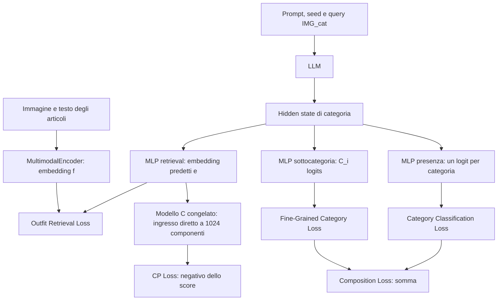

# Loss di Text2Outfit

Le loss insegnano al modello a scegliere i capi e a costruire l'outfit:

- **Retrieval:** avvicina la previsione ai capi corretti del catalogo.
- **Compatibilità (CP):** favorisce capi che stanno bene insieme.
- **Presenza:** decide quali categorie includere nell'outfit.
- **Fine-grained:** sceglie una sottocategoria per ogni categoria presente.
- **Composizione:** somma le loss di presenza e sottocategoria.

Le funzioni ricevono embedding, punteggi delle teste MLP o score di
compatibilità già calcolati. Restituiscono uno scalare su cui eseguire
`backward()`. Encoder, LLM e teste MLP vengono costruiti dal chiamante.

## Indice

- [File](#file)
- [Flusso](#flusso)
- [API e formati](#api-e-formati)
- [Outfit Retrieval Loss](#outfit-retrieval-loss)
- [Compatibility Loss: CP](#compatibility-loss-cp)
- [Category Classification Loss](#category-classification-loss)
- [Fine-Grained Category Loss](#fine-grained-category-loss)
- [Composition Loss](#composition-loss)
- [Riduzioni e pesi](#riduzioni-e-pesi)

## File

| File | Responsabilità |
|---|---|
| `retrieval.py` | InfoNCE fra predizioni, positivi e negativi della stessa categoria. |
| `compatibility.py` | Negativo dello score di compatibilità. |
| `composition.py` | Presenza, sottocategoria e somma delle due loss. |
| `_validation.py` | Controlli condivisi su tensori e target binari. |
| `__init__.py` | Esporta le cinque funzioni pubbliche. |

## Flusso

`CategoryQueryEmbeddings` crea le query iniziali; l'LLM le trasforma negli
hidden state $h_{cat_i}$. Le teste MLP usano questi vettori per produrre
embedding di retrieval e predizioni sulle categorie.

L'ordine delle categorie deve coincidere in tutti gli input. Per le 11
query del progetto usare l'ordine definito in `model.OUTFIT_CATEGORIES`.

## API e formati

Nelle formule e nelle forme dei tensori usiamo questi simboli:

| Simbolo | Significato |
|---|---|
| $B$ | Numero di outfit nel batch. |
| $K$ | Numero di categorie considerate. |
| $D$ | Dimensione degli embedding usati per il retrieval. |
| $N$ | Numero di articoli negativi per categoria. |
| $C_i$ | Numero di sottocategorie della categoria $i$. |

Le funzioni accettano anche un sottoinsieme delle 11 categorie, purché
l'ordine e il numero di categorie coincidano fra predizioni e target.

| Funzione | Input | Output scalare |
|---|---|---|
| `outfit_retrieval_loss` | `predicted` e `positive`: $[B,K,D]$; `negatives`: $[B,K,N,D]$; `category_targets`: $[B,K]$; temperatura positiva. | InfoNCE sulle categorie presenti. |
| `compatibility_loss` | Score di forma $[B]$ o $[B,1]$, nell'intervallo $[0,1]$. | Negativo dello score medio. |
| `category_classification_loss` | Logits di presenza e target binari, entrambi di forma $[B,K]$. | Cross-entropy binaria. |
| `fine_grained_category_loss` | Lista di $K$ tensori $[B,C_i]$; target `torch.long` e presenza di forma $[B,K]$. | Cross-entropy sulle categorie presenti. |
| `composition_loss` | Logits presenza, lista logits fine-grained, target presenza e target fine-grained. | Somma delle due classificazioni. |

Le funzioni si importano da `model.losses` o direttamente da `model`.
`category_targets` può essere booleano, intero o floating point, purché
contenga solo $0$ e $1$. I logits sono i punteggi grezzi prodotti dalle teste:
vanno passati alla loss senza applicare prima sigmoid o softmax.

## Outfit Retrieval Loss

La retrieval loss confronta una previsione con il capo corretto e con altri
capi della stessa categoria. Per ogni categoria presente usa:

- $e_i$: embedding predetto a partire dall'hidden state $h_{cat_i}$;
- $f_i^+$: embedding del capo dell'outfit positivo associato al prompt;
- $f_{i,j}^-$: embedding del $j$-esimo articolo negativo della stessa categoria.

Se il positivo è un paio di scarpe, i negativi sono altre scarpe del training
set, con ID diversi. Un negativo campionato potrebbe comunque essere
compatibile: viene usato come alternativa al target noto, non come esempio
certamente incompatibile. Il chiamante campiona gli ID dal training set,
raggruppando gli articoli per categoria. La loss riceve solo i tensori:
non controlla gli ID, quindi bisogna escludere il positivo dai negativi.

I due rami producono vettori confrontabili:

- **Articolo reale:** immagine e descrizione passano dagli encoder, dalla
  concatenazione e dall'MLP item, ottenendo $f_i$.
- **Predizione:** $h_{cat_i}$ passa dall'MLP di retrieval della categoria,
  ottenendo $e_i$.

Con gli shard di `scripts.precompute_embeddings` applicare ancora l'MLP item
ai positivi e ai negativi: la cache contiene la concatenazione prima della
testa. Gli embedding finali $e_i$ e $f_i$ devono avere la stessa dimensione $D$.
Il gradiente raggiunge anche la testa MLP item.

La funzione implementa la InfoNCE standard:

$$
\ell_i=-\log\frac{\exp(\cos(e_i,f_i^+)/\tau)}
{\exp(\cos(e_i,f_i^+)/\tau)+\sum_j\exp(\cos(e_i,f_{i,j}^-)/\tau)}.
$$

La similarità coseno confronta la previsione con ciascun candidato. Dopo
la normalizzazione dei punteggi, la frazione rappresenta la probabilità
assegnata al positivo. La loss $-\log(p)$ diminuisce quando questa probabilità
aumenta: $p=0.9$ dà circa $0.105$, mentre $p=0.1$ dà circa $2.303$.

La temperatura $\tau$ controlla quanto la distribuzione privilegia i
punteggi più alti. Il default $\tau=0.07$ è una scelta di questo modulo,
da tarare per il training.

Si normalizzano internamente gli embedding per calcolare la similarità
coseno. La cross-entropy sui punteggi include il positivo nel denominatore
e evita il calcolo esplicito di esponenziali e logaritmi. Le categorie assenti
sono escluse dal confronto.

## Compatibility Loss: CP

Questa loss valuta gli embedding predetti come insieme. Il modello di
compatibilità $C$, già addestrato, assegna uno score all'outfit. In questa
implementazione gli embedding retrieval $e$ entrano direttamente in $C$,
senza adattatore; la loro dimensione deve coincidere con l'ingresso CP:

$$
\mathcal L_{cp}(e)=-C(e).
$$

`compatibility_loss` riceve gli score già calcolati e restituisce la loro
media cambiata di segno, conservando il gradiente.

| Score restituito da $C$ | Loss del singolo outfit |
|---:|---:|
| $1.0$ | $-1.0$ |
| $0.8$ | $-0.8$ |
| $0.0$ | $0.0$ |

Minimizzare la loss massimizza lo score. Il minimo non deve essere zero:
con score in $[0,1]$ è $-1$. La variante $1-C(e)$ avrebbe gli stessi
gradienti. L'Eq. (4) del paper include anche una proiezione $W_{cp}$, omessa
in questa variante: l'allineamento con il CP viene appreso dalle teste retrieval.

Uno score pari a $0.8$ può essere mostrato come $80\%$, ma alla loss si
passa il valore $0.8$. Il modulo rifiuta valori fuori da $[0,1]$ e non
applica sigmoid ai logits.
Lo score non è necessariamente una probabilità calibrata.

Il chiamante congela $C$ con `requires_grad_(False)` e lo imposta in `eval()`.
Non usare `torch.no_grad()`, `torch.inference_mode()` o `detach()` nel ramo
CP durante il training: i gradienti devono attraversare $C$ per aggiornare
il ramo predittivo, anche se i pesi di $C$ restano fermi. La loss
non carica né congela automaticamente il modello.

Si lavora direttamente sugli embedding predetti, senza passare attraverso
la selezione discreta dei vicini nel catalogo.

## Category Classification Loss

Decide se ogni categoria deve comparire nell'outfit. Per esempio, la query
`IMG_shoes` deve indicare se includere delle scarpe. La testa produce un
**logit**, cioè un punteggio reale non ancora convertito in probabilità,
per ciascuna categoria: il tensore ha forma $[B,K]$.

Per l'outfit $b$ e la categoria $i$:

- $z_{b,i}$: logit prodotto dalla testa MLP di presenza;
- $y_{b,i}$: target reale, $1$ se la categoria è presente, $0$ se è assente;
- $p_{b,i}$: probabilità predetta di presenza, ottenuta con sigmoid.

$$
p_{b,i}=\sigma(z_{b,i})=\frac{1}{1+\exp(-z_{b,i})}.
$$

La cross-entropy binaria del singolo caso è:

$$
\ell^{cat}_{b,i}
=-\left[y_{b,i}\log(p_{b,i})
+(1-y_{b,i})\log(1-p_{b,i})\right].
$$

Il target decide quale dei due termini conta:

- Se $y_{b,i}=1$, la loss è $-\log(p_{b,i})$: premia probabilità vicine a $1$.
- Se $y_{b,i}=0$, la loss è $-\log(1-p_{b,i})$: premia probabilità vicine a $0$.

Una previsione sicura ma sbagliata produce quindi una penalizzazione alta.
Tutti i logaritmi usati nelle formule sono naturali.

| Target | Probabilità di presenza | Loss del singolo caso |
|---:|---:|---:|
| $1$ | $0.9$ | $-\log(0.9)\approx 0.105$ |
| $1$ | $0.1$ | $-\log(0.1)\approx 2.303$ |
| $0$ | $0.1$ | $-\log(0.9)\approx 0.105$ |
| $0$ | $0.9$ | $-\log(0.1)\approx 2.303$ |

La funzione somma le categorie e fa la media sugli outfit:

$$
\mathcal L_{cat}=\frac{1}{B}\sum_{b=1}^{B}\sum_{i=1}^{K}\ell^{cat}_{b,i}.
$$

Nel codice si usa `binary_cross_entropy_with_logits`, che combina sigmoid e
cross-entropy in un calcolo numericamente stabile. Alla funzione si passano
quindi i logits $z$, senza convertirli prima nelle probabilità $p$.
Un logit positivo favorisce la presenza, uno negativo l'assenza;
$z=0$ corrisponde a $p=0.5$.

Ogni categoria ha una decisione binaria propria: nello stesso outfit possono
essere presenti contemporaneamente `tops`, `bottoms` e `shoes`. Non si applica
una softmax fra le categorie generali.

Se usi `MLP(..., output_dim=1)` sugli hidden state di forma $[B,K,H]$, dove
$H$ è la dimensione dell'hidden state, il risultato ha forma $[B,K,1]$.
Applica `.squeeze(-1)` per ottenere $[B,K]$ prima di passarlo alla loss.

Tutte le categorie ricevono supervisione, comprese quelle assenti. Predire
un capospalla quando il target è $0$ deve produrre una penalizzazione.

## Fine-Grained Category Loss

Sceglie **quale sottocategoria** usare per una categoria presente: per esempio
sandali o scarpe da ginnastica per `shoes`, camicia o maglietta per `tops`.
Sono esempi illustrativi: la tassonomia effettiva viene definita dai dati
di training. Qui ogni categoria presente ha un solo target fine-grained.

Ogni categoria ha una testa che produce logits di forma $[B,C_i]$.
Il numero $C_i$ può cambiare fra le teste: per esempio, `shoes` e `tops`
possono avere numeri diversi di sottocategorie.

I target sono indici locali da $0$ a $C_i-1$. Il chiamante definisce e salva
una mappatura nomi/indici per ogni testa: lo stesso indice può indicare
sottocategorie diverse in teste diverse.

Per l'outfit $b$, la categoria $i$ e la sottocategoria $c$:

- $z^{fg}_{b,i,c}$: logit della sottocategoria $c$;
- $t_{b,i}$: indice della sottocategoria corretta;
- $q_{b,i,c}$: probabilità predetta della sottocategoria, ottenuta con softmax.

$$
q_{b,i,c}=\frac{\exp(z^{fg}_{b,i,c})}
{\sum_{r=0}^{C_i-1}\exp(z^{fg}_{b,i,r})}.
$$

La softmax converte i punteggi della testa in una distribuzione sulle sue
$C_i$ sottocategorie. La loss considera la probabilità assegnata al target
corretto: più è alta, più il contributo è basso. Se la categoria è assente,
non c'è una sottocategoria da scegliere e il contributo è zero:

$$
\ell^{fg}_{b,i}=
\begin{cases}
-\log(q_{b,i,t_{b,i}}), & y_{b,i}=1,\\
0, & y_{b,i}=0.
\end{cases}
$$

$y_{b,i}$ è lo stesso target di presenza usato dalla Category Classification
Loss. Si sommano i contributi delle categorie e si fa la media sugli outfit:

$$
\mathcal L_{fg}=\frac{1}{B}\sum_{b=1}^{B}\sum_{i=1}^{K}\ell^{fg}_{b,i}.
$$

Esempio: la categoria `shoes` è presente e la testa assegna queste probabilità:

| Indice locale | Sottocategoria | Probabilità |
|---:|---|---:|
| $0$ | Scarpe da ginnastica | $0.1$ |
| $1$ | Sandali | $0.7$ |
| $2$ | Stivali | $0.2$ |

Se il target è $t_{b,i}=1$, cioè sandali, il contributo è
$-\log(0.7)\approx 0.357$. Se la probabilità dei sandali scendesse a $0.1$,
il contributo salirebbe a circa $2.303$. Le probabilità della stessa testa
sommano a $1$: in questo esempio $0.1+0.7+0.2=1$.

Nel codice si usa `cross_entropy`, che calcola questo obiettivo direttamente
dai logits con log-softmax numericamente stabile. Anche qui non bisogna
applicare softmax prima di chiamare la loss.

La maschera si basa sul target reale `category_targets`, non sulla presenza
predetta dal modello. Per una categoria assente si ignora il target
fine-grained; si può indicarlo con $-100$. Per una categoria presente serve
invece un indice valido: $-100$ non può sostituire l'etichetta di un capo presente.

## Composition Loss

La Composition Loss unisce le due decisioni: quali categorie includere e
quale sottocategoria scegliere per ciascuna di quelle presenti.

$$
\mathcal L_{comp}=\mathcal L_{cat}+\mathcal L_{fg}.
$$

| Categoria | Target presenza | Target fine-grained |
|---|---:|---|
| Tops | $1$ | Maglietta |
| Shoes | $1$ | Sandali |
| Outerwear | $0$ | Ignorato |

La presence loss insegna a includere `tops` e `shoes` ed escludere
`outerwear`; la fine-grained loss insegna le sottocategorie. Il retrieval
serve poi a individuare gli articoli concreti del catalogo.

Per un esempio numerico consideriamo un solo outfit con `shoes` presente
e `outerwear` assente. Il modello assegna probabilità di presenza $0.9$
alle scarpe e $0.1$ al capospalla; assegna inoltre probabilità $0.7$ alla
sottocategoria corretta delle scarpe.

| Componente | Calcolo | Valore approssimato |
|---|---|---:|
| Presenza delle due categorie | $-\log(0.9)-\log(1-0.1)$ | $0.211$ |
| Sottocategoria delle scarpe | $-\log(0.7)$ | $0.357$ |
| Composizione | $\mathcal L_{cat}+\mathcal L_{fg}$ | $0.567$ |

Il capospalla assente contribuisce alla loss di presenza, ma non alla
fine-grained. La somma finale viene calcolata prima dell'arrotondamento.

## Riduzioni e pesi

Retrieval e classificazioni sommano le categorie per ciascun outfit e
fanno la media sul batch:

$$
\mathcal L=\frac{1}{B}\sum_{b=1}^{B}\sum_{i=1}^{K}m_{b,i}\ell_{b,i}.
$$

$m_{b,i}$ decide se un contributo va incluso: coincide con il target di
presenza $y_{b,i}$ per retrieval e fine-grained, mentre vale sempre $1$
per la loss di presenza. CP fa la media negativa degli score per outfit.
Composition somma le due classificazioni già ridotte nello stesso modo.

La divisione è solo per $B$, non per il numero di categorie presenti:
un outfit con più categorie supervisionate contribuisce con più termini.
La media sul batch è una scelta del modulo, applicata alla somma sulle
categorie del paper.

Durante il training si assegnano pesi $\lambda$ ai diversi obiettivi. Per
esempio, nel seed-to-outfit si possono combinare così:

$$
\mathcal L_{tot}=\lambda_{ret}\mathcal L_{ret}
+\lambda_{cp}\mathcal L_{cp}+\lambda_{comp}\mathcal L_{comp}.
$$

La CP può essere negativa e le altre loss positive. Non è necessario che
il totale abbia minimo zero; i pesi vanno tarati tenendo conto delle scale.
