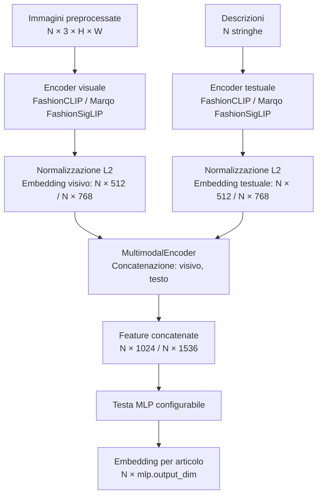

# Multimodal representation: rappresentazione degli articoli

## Indice

- [File](#file)
- [Architettura](#architettura)
- [Scopo](#scopo)
- [API del modello](#api-del-modello)
- [Encoder visuale e testuale](#encoder-visuale-e-testuale)
- [Output](#output)
- [Esempi](#esempi)
- [Modularità e limiti](#modularità-e-limiti)

## File

| File | Cosa fa |
|---|---|
| `image_encoder.py` | Definisce `VisualEncoder` e gli encoder visuali FashionCLIP ViT e Marqo FashionSigLIP. |
| `text_encoder.py` | Definisce `TextEncoder` e gli encoder testuali FashionCLIP e Marqo FashionSigLIP. |
| `multimodal_encoder.py` | Concatena gli embedding visivo e testuale normalizzati L2 e li passa alla testa MLP. |
| `_marqo.py` | Condivide caricamento, contratti e validazione delle dimensioni del backbone Marqo. |
| `__init__.py` | Espone i componenti pubblici di `model.multimodal_representation`. |
| `README.md` | Documenta concetti, comportamento e limiti del modulo. |

## Architettura

Il diagramma mostra le dimensioni per modalità: `512 / 768`, rispettivamente
FashionCLIP e Marqo FashionSigLIP. Ogni encoder espone la dimensione effettiva
tramite `output_dim`.



## Scopo

Il modulo crea le rappresentazioni visuali e testuali degli articoli. Ogni
immagine e ogni descrizione diventano un vettore nel rispettivo spazio del
checkpoint scelto, normalizzato L2. `MultimodalEncoder` concatena i due vettori
nell’ordine visivo, testo, poi applica una testa `MLP` per ottenere l'embedding
finale per articolo.

Gli encoder sono indipendenti dalla sorgente dei dati e conservano i contratti
`VisualEncoder` e `TextEncoder` del codice originale.

## API del modello

Qui **API** vuol dire semplicemente: come passiamo i dati al modello e cosa il
modello ci restituisce.

L’encoder visuale riceve un tensore `[N, 3, H, W]`. L’encoder testuale riceve
una sequenza di `N` descrizioni. Entrambi restituiscono un tensore `[N, D]`,
dove `D` è la proprietà `output_dim`. `MultimodalEncoder(visual_encoder,
text_encoder, mlp)` riceve entrambi gli input e restituisce `[N, mlp.output_dim]`;
il numero e l’ordine degli articoli devono coincidere nelle due modalità.

La testa e un'istanza di `model.MLP`, obbligatoria e configurabile in larghezza,
profondita e dimensione finale. Il suo `input_dim` deve essere
`visual_encoder.output_dim + text_encoder.output_dim`: 1024 per FashionCLIP
o 1536 per Marqo con i checkpoint predefiniti. Un valore incompatibile viene
rifiutato alla costruzione. `encoder.output_dim` restituisce `mlp.output_dim`.

Le immagini devono essere già preparate per l’encoder visuale scelto e avere
forme compatibili nello stesso batch. Si usano
`data.build_fashion_clip_transform()` oppure
`data.build_marqo_fashion_siglip_transform()` con lo stesso checkpoint
dell’encoder. Tokenizzazione, padding e troncamento del testo appartengono
all’encoder testuale.

Esempio concettuale con input già preparati:

```python
from model import MLP, MultimodalEncoder

mlp = MLP(visual_encoder.output_dim + text_encoder.output_dim, 256, hidden_dims=[512, 256])
encoder = MultimodalEncoder(visual_encoder, text_encoder, mlp)
embeddings = encoder(images, descriptions)
```

Gli encoder sono moduli PyTorch e supportano `.to(device)`, `.train()` ed
`.eval()`. Le immagini devono essere sul dispositivo dell’encoder visuale;
i token vengono trasferiti automaticamente sul dispositivo dell’encoder testo.

## Encoder visuale e testuale

Ogni encoder dichiara la dimensione del proprio output. Sono conservate le
feature native del checkpoint, senza aggiungere proiezioni dimensionali.

Encoder visuali disponibili:

- **FashionCLIP ViT**: visual tower di FashionCLIP, backbone allenabile per
  impostazione predefinita;
- **Marqo FashionSigLIP**: visual tower del modello Marqo, backbone congelato.

Encoder testuali disponibili:

- **FashionCLIP text tower**: tokenizzazione inclusa e backbone allenabile per
  impostazione predefinita;
- **Marqo FashionSigLIP**: processor ufficiale, pulizia del testo, padding fisso
  e troncamento al `context_length` del backbone.

FashionCLIP usa `CLIPVisionModelWithProjection` e
`CLIPTextModelWithProjection`; normalizza L2 `image_embeds` e `text_embeds`.
Il tokenizer tronca a `max_position_embeddings` del checkpoint.
Marqo usa `get_image_features(..., normalize=False)` e
`get_text_features(..., normalize=False)`, poi applica L2 alle feature restituite.

Con `trainable=False`, FashionCLIP disattiva i gradienti dei parametri e mantiene
il backbone in evaluation anche dopo `.train()`. Marqo applica sempre questo
comportamento. Per l’inferenza si usa anche `torch.inference_mode()`.

La testa MLP resta allenabile anche con entrambi gli encoder congelati.
Per addestrarla chiamare il modello senza `torch.inference_mode()`; i gradienti
raggiungono anche i backbone FashionCLIP quando sono allenabili.

Marqo può condividere un solo backbone congelato: dopo aver creato l’encoder
visuale, passare `backbone=visual_encoder.backbone` all’encoder testuale. Senza
questo argomento il testo carica una propria istanza. Il `model_name` del
processor deve corrispondere al backbone condiviso.

## Output

| Encoder | Forma con il checkpoint predefinito | Significato |
|---|---|---|
| `FashionCLIPVisualEncoder` | `[N, 512]` | Embedding dell’immagine normalizzato L2. |
| `FashionCLIPTextEncoder` | `[N, 512]` | Embedding della descrizione normalizzato L2. |
| `MarqoFashionSigLIPVisualEncoder` | `[N, 768]` | Embedding dell’immagine normalizzato L2. |
| `MarqoFashionSigLIPTextEncoder` | `[N, 768]` | Embedding della descrizione normalizzato L2. |
| `MultimodalEncoder` con FashionCLIP | `[N, mlp.output_dim]` | Testa MLP sulle 1024 feature concatenate. |
| `MultimodalEncoder` con Marqo | `[N, mlp.output_dim]` | Testa MLP sulle 1536 feature concatenate. |

`N` indica il numero di articoli. La normalizzazione usa
`torch.nn.functional.normalize(..., p=2, dim=-1)`: ogni embedding di modalità
ha norma unitaria; un vettore nullo resta nullo senza divisioni per zero.
La concatenazione non applica un’altra normalizzazione: con entrambe le
modalità di norma unitaria, l'input alla testa MLP ha norma `sqrt(2)`.
L'output della testa e lineare e non viene normalizzato: la sua norma dipende
dai pesi appresi. L'MLP parte con pesi casuali e va addestrato.

Lo script di precomputazione salva le feature concatenate prima della testa,
cosi possono essere riutilizzate durante il training con `encoder.mlp`.

## Esempi

### FashionCLIP

```python
from PIL import Image
import torch

from data import build_fashion_clip_transform
from model import FashionCLIPTextEncoder, FashionCLIPVisualEncoder, MLP, MultimodalEncoder

device = torch.device("cuda" if torch.cuda.is_available() else "cpu")
transform = build_fashion_clip_transform()
image = Image.open("camicia.jpg").convert("RGB")
images = transform(image).unsqueeze(0).to(device)

encoder = MultimodalEncoder(
    FashionCLIPVisualEncoder(trainable=False),
    FashionCLIPTextEncoder(trainable=False),
    MLP(input_dim=1024, output_dim=256, hidden_dims=[512, 256]),
).to(device).eval()
with torch.inference_mode():
    embeddings = encoder(images, ["white shirt"])  # [1, 256]
```

### Marqo FashionSigLIP

```python
from PIL import Image
import torch

from data import build_marqo_fashion_siglip_transform
from model import (
    MarqoFashionSigLIPTextEncoder,
    MarqoFashionSigLIPVisualEncoder,
    MLP,
    MultimodalEncoder,
)

transform = build_marqo_fashion_siglip_transform()
image = Image.open("camicia.jpg").convert("RGB")
images = transform(image).unsqueeze(0)

visual_encoder = MarqoFashionSigLIPVisualEncoder().eval()
text_encoder = MarqoFashionSigLIPTextEncoder(
    backbone=visual_encoder.backbone,
).eval()
mlp = MLP(input_dim=1536, output_dim=256, hidden_dims=[768, 256])
encoder = MultimodalEncoder(visual_encoder, text_encoder, mlp).eval()
with torch.inference_mode():
    embeddings = encoder(images, ["white shirt"])  # [1, 256]
```

## Modularità e limiti

Sono conservati i controlli su batch vuoti, numero di canali, descrizioni vuote
e dimensioni dichiarate dal backbone. FashionCLIP verifica `projection_dim` e
il limite dei token; Marqo richiede dimensioni e lunghezza del contesto intere
positive.

`MultimodalEncoder` richiede batch allineati; i controlli di canali, batch vuoti
e descrizioni restano negli encoder di modalità. Le trasformazioni devono
corrispondere al checkpoint; l’encoder non può rilevare una normalizzazione
dei pixel sbagliata.

Il caricamento Marqo mantiene `trust_remote_code=True` e
`low_cpu_mem_usage=False`, come il wrapper originale. Le dipendenze in
`requirements.txt` conservano `transformers>=4.41,<4.50`, OpenCLIP,
SentencePiece e ftfy. Le risorse dei checkpoint possono essere scaricate al
primo utilizzo; i test locali non scaricano pesi.
