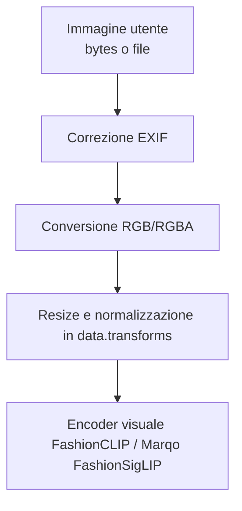

# Preprocessing immagini

Modulo per preparare immagini utente prima di passarle al modello.

## Indice

- [Flusso completo](#flusso-completo)
- [Stato attuale](#stato-attuale)
- [Moduli](#moduli)
- [Uso rapido](#uso-rapido)
- [Note](#note)

## Flusso completo

Il grafico mostra il flusso logico del preprocessing. Lo stato di avanzamento
dei singoli step e' indicato nella sezione [Stato attuale](#stato-attuale).



### Cosa fa ogni passaggio

| Passaggio | Cosa fa | Cosa passa al prossimo passaggio |
|---|---|---|
| Immagine utente | Riceve l'immagine caricata dall'utente, come file o bytes. | Immagine grezza da aprire con Pillow. |
| Correzione EXIF | Applica l'orientamento salvato nei metadati della foto, utile soprattutto per immagini da telefono. | `PIL.Image` orientata correttamente. |
| Conversione RGB/RGBA | Porta l'immagine in un formato prevedibile. `RGBA` serve quando vogliamo usare la trasparenza. | `PIL.Image` normalizzata in `RGB` o `RGBA`. |
| Resize e normalizzazione modello | Applica dimensione, tensorizzazione e normalizzazione attese dal modello. | Tensore immagine `[3, H, W]` richiesto dall’encoder visuale. |
| Encoder visuale | Usa l'immagine preprocessata. | Feature visuali FashionCLIP o Marqo FashionSigLIP. |

Lettura, orientamento e colore appartengono a questo package. Resize e
normalizzazione sono definiti in `data.transforms`; la codifica appartiene a
`model.multimodal_representation`.

## Stato attuale

| Step | Stato | File |
|---|---|---|
| Lettura immagine da path o bytes | Implementato | `image_loader.py` |
| Correzione orientamento EXIF | Implementato | `image_loader.py` |
| Conversione in `RGB` o `RGBA` | Implementato | `image_loader.py` |

## Moduli

### `image_loader.py`

Responsabilita:

- legge immagini da `bytes` o path;
- corregge orientamento EXIF con Pillow;
- converte immagine in `RGB` o `RGBA`;
- ritorna sempre una `PIL.Image` caricata e pronta.

API principali:

```python
load_image_from_bytes(image_bytes, mode="RGB")
load_image_from_path(path, mode="RGB")
normalize_image(image, mode="RGB")
```

## Uso rapido

```python
from preprocessing import load_image_from_bytes, load_image_from_path

image = load_image_from_path("shirt.jpg", mode="RGB")
image_rgba = load_image_from_path("shirt.jpg", mode="RGBA")
with open("shirt.jpg", "rb") as source:
    image_from_bytes = load_image_from_bytes(source.read(), mode="RGB")
```

Il risultato è sempre una `PIL.Image` caricata, utilizzabile anche dopo la
chiusura del file sorgente. Per prepararla per l’encoder applicare la transform
corrispondente del modulo `data`.

## Note

- `RGB` e' utile per input modello a 3 canali.
- `RGBA` e' utile durante preprocessing per usare trasparenza/alpha.
- I bytes vuoti e le modalità diverse da `RGB`/`RGBA` vengono rifiutati.
- Errori di apertura o decodifica vengono propagati al chiamante.
