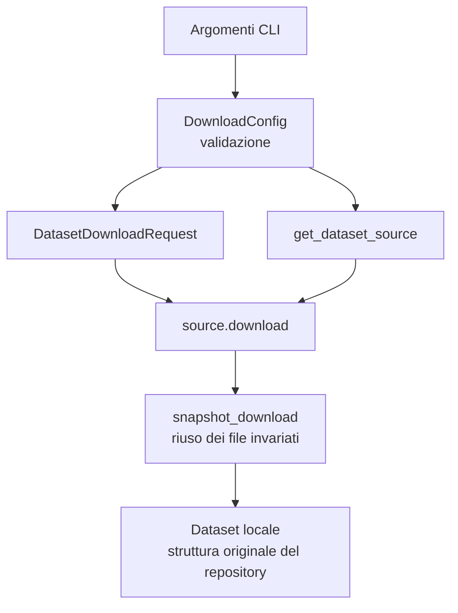

# Script di supporto

Questa cartella contiene gli strumenti eseguibili che preparano i dati usati dal progetto senza partecipare direttamente all'addestramento.

## Indice

- [File](#file)
- [Download Polyvore](#download-polyvore)
- [Precomputare gli embedding](#precomputare-gli-embedding)
- [Controlli e sicurezza](#controlli-e-sicurezza)
- [Artefatti prodotti](#artefatti-prodotti)
- [Esempi](#esempi)

## File

| File | Funzione concettuale |
| --- | --- |
| `download_polyvore.py` | Scarica intero repository Polyvore nella cartella locale usata dal progetto. |
| `precompute_embeddings.py` | Precomputa gli embedding FashionCLIP o Marqo FashionSigLIP in shard PyTorch con manifest. |

## Download Polyvore

Scarica entrambe le varianti e tutti gli split nella destinazione predefinita:

PowerShell:

```powershell
python -m scripts.download_polyvore
```

Linux (Bash):

```bash
python -m scripts.download_polyvore
```

Destinazione predefinita: `datasets/polyvore-outfits`. File invariati già
presenti vengono riusati. Struttura del repository resta invariata, quindi
il catalogo e i DataLoader trovano subito le risorse locali.

### Opzioni

| Flag | Default | Cosa fa |
| --- | --- | --- |
| `--dataset` | `polyvore` | Seleziona la source registrata. |
| `--output-dir` | `datasets/polyvore-outfits` | Imposta cartella locale del dataset. |
| `--cache-dir` | non impostato | Indica cache Hugging Face personalizzata. |
| `--revision` | revisione predefinita | Blocca download a branch, tag o commit. |
| `--max-workers` | `8` | Imposta download paralleli. |
| `--force-download` | disattivato | Riscarica anche file già presenti o in cache. |
| `--token` | credenziali locali | Usa token Hugging Face esplicito. |
| `--no-token` | disattivato | Forza accesso anonimo. |
| `-h`, `--help` | — | Mostra la guida dei comandi e termina. |

## Controlli e sicurezza

Prima del download vengono verificati il nome della source, il numero positivo
di worker e il percorso di destinazione. `--token` e `--no-token` sono
mutuamente esclusivi. La directory restituita dal download deve esistere.



## Artefatti prodotti

La destinazione predefinita è `datasets/polyvore-outfits/`.

| Artefatto | Contenuto concettuale |
|---|---|
| Directory del dataset | File del repository Polyvore con la struttura originale. |
| Console | Identità del dataset, destinazione e completamento del download. |

I file invariati già disponibili vengono riutilizzati dal client Hugging Face.

## Esempi

Destinazione personalizzata, valido in PowerShell e Bash:

```bash
python -m scripts.download_polyvore --output-dir datasets/polyvore-outfits
```

Consultare tutti i flag:

```bash
python -m scripts.download_polyvore --help
```

Le stesse opzioni sono accessibili da Python tramite `DownloadConfig`,
`parse_args` e `download_dataset`.

## Precomputare gli embedding

Script adattato da `OutfitTransformer/scripts/precompute_embeddings.py`.
Usa gli encoder locali congelati, senza gradienti. Ogni riga contiene prima
l'embedding visivo normalizzato L2, poi quello testuale normalizzato L2:
1024 feature per FashionCLIP, 1536 per Marqo. Non normalizza il concatenato.
Marqo condivide un solo backbone fra le due modalita.

Eseguire dalla root del progetto, con le dipendenze installate. Ogni comando
elabora una sola combinazione di modello, variante e split:

- `--subset disjoint` oppure `--subset nondisjoint` sceglie la variante.
- `--split train`, `--split validation` oppure `--split test` sceglie lo split.
- Senza questi flag si usa FashionCLIP, variante `nondisjoint`, split `train`.

Gli esempi seguenti sono alternativi: eseguire i comandi delle combinazioni
che servono, oppure usare uno dei cicli per elaborarle tutte. I comandi
singoli funzionano sia in PowerShell sia in Bash.

### FashionCLIP: varianti e split

Variante `nondisjoint`, rispettivamente training, validazione e test:

```bash
python -m scripts.precompute_embeddings --subset nondisjoint --split train
python -m scripts.precompute_embeddings --subset nondisjoint --split validation
python -m scripts.precompute_embeddings --subset nondisjoint --split test
```

Variante `disjoint`, rispettivamente training, validazione e test:

```bash
python -m scripts.precompute_embeddings --subset disjoint --split train
python -m scripts.precompute_embeddings --subset disjoint --split validation
python -m scripts.precompute_embeddings --subset disjoint --split test
```

### Marqo FashionSigLIP: varianti e split

Aggiungere `--marqo-fashion-siglip` per selezionare Marqo. In questi esempi
si usa un batch di 32 articoli.

Variante `nondisjoint`:

```bash
python -m scripts.precompute_embeddings --marqo-fashion-siglip --subset nondisjoint --split train --batch-size 32
python -m scripts.precompute_embeddings --marqo-fashion-siglip --subset nondisjoint --split validation --batch-size 32
python -m scripts.precompute_embeddings --marqo-fashion-siglip --subset nondisjoint --split test --batch-size 32
```

Variante `disjoint`:

```bash
python -m scripts.precompute_embeddings --marqo-fashion-siglip --subset disjoint --split train --batch-size 32
python -m scripts.precompute_embeddings --marqo-fashion-siglip --subset disjoint --split validation --batch-size 32
python -m scripts.precompute_embeddings --marqo-fashion-siglip --subset disjoint --split test --batch-size 32
```

### Elaborare entrambe le varianti e tutti gli split

Questi cicli eseguono le sei combinazioni con FashionCLIP.

PowerShell:

```powershell
foreach ($subset in @("disjoint", "nondisjoint")) {
    foreach ($split in @("train", "validation", "test")) {
        python -m scripts.precompute_embeddings --subset $subset --split $split
    }
}
```

Bash:

```bash
for subset in disjoint nondisjoint; do
    for split in train validation test; do
        python -m scripts.precompute_embeddings --subset "$subset" --split "$split"
    done
done
```

Per usare Marqo nei cicli, aggiungere `--marqo-fashion-siglip --batch-size 32`
alla chiamata di `scripts.precompute_embeddings`.

### Prova rapida su pochi articoli

Precomputare soltanto 100 articoli di training, con batch da 16. La directory
separata evita di confondere la prova con la cache dello split completo:

```bash
python -m scripts.precompute_embeddings --subset nondisjoint --split train --limit 100 --batch-size 16 --output-dir precomputed_embeddings-smoke
```

### Riutilizzare il dataset di OutfitTransformer

Leggere gli articoli dalla cartella del progetto originale e salvare gli
embedding nella directory predefinita di Text2Outfit:

```powershell
python -m scripts.precompute_embeddings --dataset-root "C:\Users\filix\Desktop\OutfitTransformer\datasets\polyvore-outfits" --subset disjoint --split validation --batch-size 32
```

### Dispositivo, precisione e destinazione

FashionCLIP su CPU, con batch piccoli:

```bash
python -m scripts.precompute_embeddings --subset disjoint --split test --device cpu --batch-size 16
```

Marqo su GPU CUDA disponibile, con shard da 5000 articoli, output salvato
in `float16` e directory personalizzata:

```bash
python -m scripts.precompute_embeddings --marqo-fashion-siglip --subset nondisjoint --split train --device cuda --batch-size 32 --shard-size 5000 --output-dtype float16 --output-dir precomputed_embeddings-float16
```

La precisione `--output-dtype` riguarda i tensori salvati su disco.

### Rigenerare una cache esistente

Per sostituire la cache FashionCLIP di validazione `disjoint`:

```bash
python -m scripts.precompute_embeddings --subset disjoint --split validation --overwrite
```

`--overwrite` sostituisce soltanto la destinazione del modello, della
variante e dello split selezionati. Senza questo flag, una directory gia
popolata viene rifiutata; il job non riprende automaticamente dal punto
in cui si era interrotto.

### Opzioni di precomputazione

| Flag | Default | Funzione |
|---|---|---|
| `--dataset` | `polyvore` | Source registrata. |
| `--subset` | `nondisjoint` | Variante Polyvore, anche `disjoint`. |
| `--split` | `train` | `train`, `validation` o `test`. |
| `--marqo-fashion-siglip` | disattivato | Seleziona Marqo invece di FashionCLIP. |
| `--model-name` | checkpoint del backend scelto | Checkpoint compatibile; il nome Marqo predefinito seleziona anche il backend. |
| `--dataset-root` | `datasets/polyvore-outfits` | Directory locale del dataset. |
| `--cache-dir` | cache Hugging Face | Cache dei dati. |
| `--output-dir` | `precomputed_embeddings` | Directory base degli embedding. |
| `--batch-size` | `128` | Articoli per batch; ridurre in caso di memoria insufficiente. |
| `--num-workers` | `0` | Worker del DataLoader. |
| `--shard-size` | `10000` | Numero massimo di righe per file. |
| `--output-dtype` | `float32` | Precisione salvata: `float32` o `float16`. |
| `--device` | `auto` | Preferisce CUDA, poi MPS, poi CPU. |
| `--limit` | nessuno | Limite di articoli, anche inferiore a un batch. |
| `--overwrite` | disattivato | Sostituisce una cache precedente nella stessa destinazione. |
| `--log-every` | `25` | Frequenza dei log, in batch. |
| `--token` / `--no-token` | credenziali locali | Autenticazione del dataset. |

La cache si trova in
`precomputed_embeddings/<modello>/<subset>/<split>/`. Contiene
`shard-00000.pt`, gli shard successivi e `manifest.json`. Il manifest
registra numero di righe, dimensione, dtype, intervalli degli shard,
dataset e fingerprint degli encoder. Il formato resta schema versione 2
del progetto originale.

Ogni shard contiene `item_ids` ed `embeddings`, allineati per riga.

Scrittura atomica per ciascun file; il manifest viene pubblicato solo al
completamento. ID duplicati, forme errate, vettori nulli, valori non finiti
e overflow nel dtype di output interrompono il job. Senza `--overwrite`
una directory non vuota viene rifiutata. Con `--overwrite` si controlla
l'intera directory prima di cancellare: file estranei fanno fallire il
controllo senza cancellare la cache. La sostituzione completa della cache
non e una transazione: un errore durante il job puo lasciare shard parziali;
per ripartire occorre `--overwrite` o una nuova directory.

Tutti i flag sono elencati anche da:

```bash
python -m scripts.precompute_embeddings --help
```
