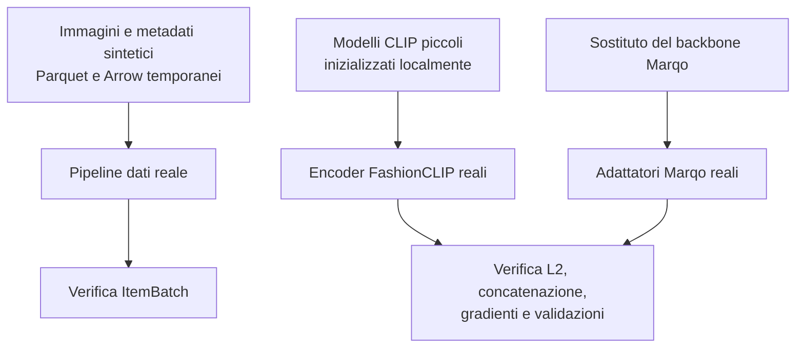

# Test della pipeline e degli encoder

## Indice

- [File](#file)
- [Flusso](#flusso)
- [Esecuzione](#esecuzione)
- [Copertura e limiti](#copertura-e-limiti)

## File

| File | Responsabilità |
|---|---|
| `test_data.py` | Verifica lettura locale, cache, fallback, catalogo, batch e downloader. |
| `test_encoders.py` | Verifica forward, L2, concatenazione e testa MLP, gradienti, tokenizzazione, condivisione Marqo, encoding del seed e input non validi. |
| `test_mlp.py` | Verifica reti indipendenti con dimensioni diverse, gradienti, output lineare, salvataggio e validazioni. |
| `test_precompute.py` | Verifica Parquet locale fino al manifest, limite articoli, shard, dtype, selezione encoder e sovrascrittura sicura. |

## Flusso



## Esecuzione

Con le dipendenze installate, dalla cartella principale:

```powershell
python -B -m unittest discover -s tests -v
```

I test dei dati creano file temporanei e una cache isolata. Le chiamate remote
sono simulate; i test degli encoder intercettano `from_pretrained` per evitare
il download dei checkpoint.

## Copertura e limiti

La pipeline dati viene eseguita da righe Parquet o Arrow fino a `ItemBatch`.
I test FashionCLIP eseguono forward e backward su piccoli backbone Transformers
con pesi casuali. I test Marqo verificano il contratto del wrapper, il riuso del
backbone, il padding e il congelamento dei parametri. Per entrambe le famiglie
si controllano la normalizzazione L2, la concatenazione visivo-testo e la
proiezione tramite MLP. La testa riceve gradienti anche con i due backbone
congelati; dimensioni incompatibili vengono rifiutate alla costruzione. Sono
coperti anche i vettori visivi nulli e il rifiuto di batch non allineati.

I test del seed verificano il riuso della stessa istanza visuale del
multimodale, immagini singole e batch, dimensioni compatibili, training
dell'MLP con backbone congelato e gradienti verso un encoder trainabile.

I test della precomputazione usano encoder sostitutivi e dati locali;
verificano anche ID duplicati, valori non finiti, overflow float16 e ordine
delle righe salvate. I test MLP eseguono forward e backward reali su quattro
reti indipendenti.

Questi controlli non misurano la qualità degli embedding e non verificano
l'inferenza con i pesi completi o la disponibilità dei servizi remoti.
